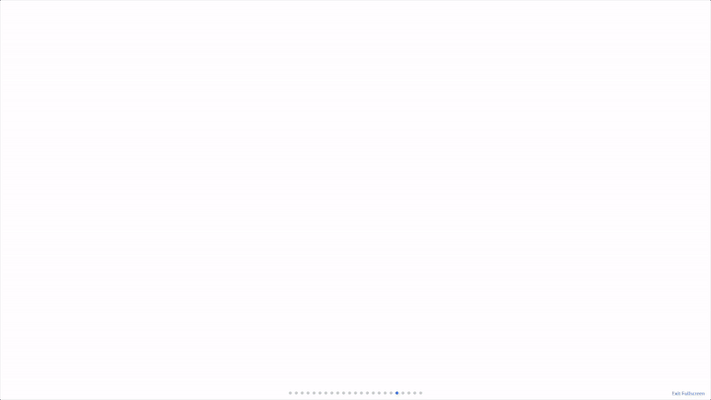

# marimo-banners

[](https://github.com/kascesar/banners/actions/workflows/ci.yml)

Composable slide presentations inside [marimo](https://marimo.io) notebooks.

Each slide is a Python object. Content is declared with dedicated classes and the layout adjusts automatically depending on what you pass.

The default look is sober and editorial: left-aligned headings in a medium weight, one accent color per palette used sparingly for rules and labels, thin lines instead of boxes, and nearly square corners. `Cover` and `Closing` use a solid dark panel; `Intro` and `Section` use a light header with an accent rule.

> **Personal note:** This project is a personal initiative to explore the capabilities of generative AI for developing complete, production-quality software projects — from architecture decisions to implementation, testing, and documentation — using [Claude Code](https://claude.ai/code) as the primary development partner.

---

## 01 · Slide types & palettes


Four slide types (`Cover`, `Intro`, `Section`, `Closing`) with five built-in palettes (`ORANGE`, `BLUE`, `GREEN`, `PURPLE`, `GRAY`) and full custom palette support.

---

## 02 · Content types


> The animations on this page were recorded with version 0.2 and still show the previous gradient style.

`Text` (markdown + LaTeX), `Image`, `Graph` (Mermaid), `AnimatedGraph` (interactive), `Table`, `Plot` (matplotlib / plotly), `FlowAnimation`, and `Manim` — all composable inside any slide.

---

## 03 · Slide backgrounds



`Background.color()`, `Background.gradient()`, and `Background.image()` — apply to any slide. Dark overlays and text contrast are handled automatically.

---

# Upgrading from 0.2

Version 0.3 changes only the visual style. The public API is the same: every class, parameter and default value from 0.2 still works, so existing decks run without code changes. What changes on screen:

- `Cover` and `Closing` render a solid, left-aligned panel instead of a centered gradient banner.
- `Intro` and `Section` render a light header with a thin accent rule instead of a colored box.
- `content_kind` renders light cards with a colored top rule instead of `mo.callout` boxes, and `Closing(stats=...)` renders a typographic row instead of `mo.stat` boxes.
- `footer` renders a small gray note below a thin rule instead of a blockquote.
- The five preset palettes (`ORANGE`, `BLUE`, `GREEN`, `PURPLE`, `GRAY`) have new, less saturated colors. Decks that need the old colors can define them with `Palette(start=..., mid=..., end=...)`; the 0.2 values are `#7c2d12`/`#c2410c`/`#ea580c` (orange), `#1e3a5f`/`#1d4ed8`/`#3b82f6` (blue), `#14532d`/`#15803d`/`#22c55e` (green), `#3b0764`/`#7e22ce`/`#a855f7` (purple) and `#111827`/`#374151`/`#6b7280` (gray).

---

# Installation

```bash
uv pip install marimo-banners
```

For animated diagrams (`FlowAnimation`, `Manim`):

```bash
uv pip install "marimo-banners[manim]"
```

`FlowAnimation` and `Manim` depend on system libraries for rendering. Install the appropriate set for your OS:

**Ubuntu / Debian**
```bash
sudo apt install python3-dev libpango1.0-dev pkg-config libcairo2-dev libx11-dev libgl1-mesa-dev ffmpeg
```

**Fedora / RHEL**
```bash
sudo dnf install gcc-c++ python3-devel pkgconf-pkg-config cairo-devel pango-devel libX11-devel mesa-libGL-devel ffmpeg
```

# Quick start

```python
from banners import configure, Background
from banners.slides import Cover, Intro, Section, Closing
from banners.content import Text, Image, Graph
from banners.palette import BLUE

# Set shared values once — all slides inherit them automatically.
configure(
    team="Analytics Team",
    date="April 2026",
    palette=BLUE,
    icon={"src": "img/logo.png"},
)

Cover(
    title="Churn Prediction v2",
    subtitle="Model migration and deployment.",
    content=[
        Text("**Accuracy** — 91% AUC on holdout."),
        Text("**Latency** — p99 under 30 ms."),
        Text("**Coverage** — All active segments."),
    ],
    content_kind="neutral",
).render()
```

# Global configuration

`configure()` sets values shared across all slides. Call it once at the top of the notebook.

| Parameter | Used by | Description |
|-----------|---------|-------------|
| `team` | `Cover`, `Intro`, `Closing` | Team line in small caps (top of the `Cover` panel, bottom of `Closing`, kicker fallback in `Intro`) |
| `date` | `Cover` | Date shown at the top right of the panel |
| `palette` | All slides | Color palette (`BLUE`, `GREEN`, etc.) |
| `icon` | All slides | Logo/icon placed next to the heading |

Calling `configure()` also resets the `Section` auto-number counter to zero.

Any slide parameter passed explicitly overrides the global value.

# Slides

| Class | Purpose | Typical position |
|-------|---------|-----------------|
| `Cover` | Solid title panel with team and date | First slide |
| `Intro` | Light header with kicker, for context or problem statement | Slides 2–3 |
| `Section` | Light header with section number, for content | Middle slides |
| `Closing` | Solid panel, mirroring `Cover`, with optional metrics row | Last slide |

All slides share these parameters:

| Parameter | Description |
|-----------|-------------|
| `title` | Main heading |
| `subtitle` | Support phrase shown below the title |
| `content` | Content element(s) displayed below the header |
| `palette` | Color palette. Defaults to orange |
| `content_kind` | Card style for `Text` items in a list: `neutral`, `info`, `success`, `warn`, `danger`. Each text goes in a light card whose top rule takes the kind's color |
| `footer` | Short note (source, closing remark) in small gray text below a thin rule |
| `icon` | Icon placed next to the heading. Falls back to the global `configure()` value |
| `background` | Custom slide background (see [Slide backgrounds](#slide-backgrounds)) |

## Section — auto-numbering

`Section` slides assign their number automatically, starting from `01` and incrementing with each new instance. The counter resets when `configure()` is called.

```python
configure(team="My Team")    # counter resets to 0

Section(title="Context")     # number = "01"
Section(title="Results")     # number = "02"
Section(title="Conclusions") # number = "03"

# Override:
Section(title="Appendix", number="A1")

# Suppress:
Section(title="No number", number="")
```

# Content elements

| Class | Renders |
|-------|---------|
| `Text(body)` | Markdown — paragraphs, lists, tables, LaTeX |
| `Image(src)` | Image from file path, bytes, or URL |
| `Graph(code)` | Static Mermaid diagram |
| `AnimatedGraph(code)` | Interactive Mermaid diagram — click to highlight nodes |
| `Table(df)` | pandas DataFrame |
| `Plot(fig)` | matplotlib or plotly figure (auto-detected) |
| `FlowAnimation(...)` | Click-to-advance animated pipeline diagram |
| `Manim(scene)` | Custom Manim `Scene` subclass (static or interactive) |

Content is passed to the `content` parameter of any slide. Layout is resolved automatically:

- **Single item** → full width.
- **List of `Text` only** → equal columns; pass `content_kind` to add a styled box.
- **List with any other element** → equal-width CSS grid, one column per item.

## AnimatedGraph

Accepts `graph LR` / `graph TD` Mermaid syntax. Clicking a node toggles a highlight color.

```python
from banners.content import AnimatedGraph

AnimatedGraph("""
graph LR
    A[Ingest] --> B[Validate]
    B --> C[Transform]
    C --> D[Load]
""", highlight_color="#3b82f6")
```

## FlowAnimation

Step-by-step pipeline animation. Each node appears on click. Requires the `manim` dependency.

```python
from banners.content import FlowAnimation

# Flat list — linear chain
FlowAnimation(["S3", "Glue", "Athena"])

# Nested list — layered topology
FlowAnimation([
    ["Ingest"],
    [{"name": "Transform A", "detail": "features"},
     {"name": "Transform B", "detail": "filters"}],
    ["Load"],
])

# Explicit graph — arbitrary connections
FlowAnimation(
    nodes=["Ingest A", "Ingest B", "Validate", "Train"],
    edges=[
        ("Ingest A", "Validate"),
        ("Ingest B", "Validate"),
        ("Validate", "Train"),
    ],
)
```

| Parameter | Default | Description |
|-----------|---------|-------------|
| `direction` | `"LR"` / `"TD"` | Flow direction — left-right or top-down |
| `quality` | `"low"` | Render quality: `"low"`, `"medium"`, `"high"` |
| `width` | `"100%"` | Player width — any CSS value |

Default direction: `"LR"` for flat lists and graphs, `"TD"` for nested lists.

## Manim

Embed any Manim `Scene` subclass — static GIF/PNG/MP4 or click-to-advance interactive mode.

```python
from manim import Scene, MathTex, Write
from banners.content import Manim

class MyScene(Scene):
    def construct(self):
        self.camera.background_color = "#0f172a"
        self.next_section("eq1")
        self.play(Write(MathTex(r"E = mc^2", font_size=72)))
        self.wait(1)
        self.next_section("eq2")
        self.play(Write(MathTex(r"\nabla^2 E = \frac{1}{c^2}\ddot{E}", font_size=52)))
        self.wait(1)

Section(
    title="Derivation",
    content=[Manim(MyScene, interactive=True, quality="medium")],
).render()
```

Renders are cached on disk (`~/.cache/banners/manim/`) keyed by scene source code — no re-rendering across notebook restarts.

# Palettes

All slides accept a `palette` parameter. The default is orange.

A palette has two roles. `start` is the solid color of the `Cover` and `Closing` panels, a deep, low-saturation tone. `end` is the accent, used sparingly for the short bar above the title, the rule under headers, kickers and section numbers. `mid` is only used by the `Palette.gradient` property, kept for custom backgrounds.

| Constant | Panel (`start`) | Accent (`end`) |
|----------|-----------------|----------------|
| `ORANGE` | `#2a1810` dark umber | `#c4561b` burnt orange |
| `BLUE` | `#0f2340` navy | `#2f6fd0` mid blue |
| `GREEN` | `#0f2a1f` dark forest | `#2e8b57` green |
| `PURPLE` | `#221a3a` deep aubergine | `#6e56cf` violet |
| `GRAY` | `#1a1d21` graphite | `#5b6470` slate |

Custom palettes: `Palette(start=..., end=...)` for any slide. `Section` also accepts a `SectionPalette(border=...)`, where `border` is the accent; a `Palette` passed to `Section` is converted automatically.

# Slide backgrounds

The `background` parameter paints the full slide area (header + content) with a custom background. Use the `Background` factory class:

```python
from banners import Background

# Solid color
Cover(title="Dark slide", background=Background.color("#0f172a"))

# Custom gradient
Section(title="Gradient", background=Background.gradient("#0d1b2a", "#4a1a6e"))
Section(title="3-stop",   background=Background.gradient("#0d1b2a", "#4a1a6e",
                                                        mid="#1a2a5e", angle=45))

# Image — dark overlay applied automatically for legibility
Cover(title="Photo", background=Background.image("assets/photo.jpg"))
Cover(title="URL",   background=Background.image("https://...", overlay="rgba(0,0,0,0.7)"))
Cover(title="Raw",   background=Background.image(raw_bytes, overlay=None))
```

When `background` is set and `content_kind` is not, the content text color is chosen automatically based on the background luminance. Passing `content_kind` explicitly disables this: the text goes in light cards, which stay legible on any background.

On a dark background (one whose automatic text color is white), the titles, subtitles, kickers, section numbers and rules drawn directly on the slide switch to white or translucent white. The accent color stays only on the short rule segments and bars.

# Templates (fixed 16:9 slides)

By default slides use the editorial style, which flows with the notebook width.
A `Template` renders every slide on a fixed 16:9 canvas instead, like a
corporate PowerPoint master: positions and font sizes are relative to the slide
width (`cqw` units), so the deck keeps its proportions and stays legible on any
screen. Use it to reproduce your organization's template while keeping every
banners feature (Mermaid, plots, tables, Manim).

```python
from banners import Template, configure
from banners.content import Plot, Text
from banners.slides import Closing, Cover, Intro, Section

corp = Template(
    primary="#ff6600",                   # titles + main segment of the bottom bar
    secondary="#054af6",                 # end segment of the bottom bar
    logo_on_dark="assets/logo_white.png",
    logo_on_light="assets/logo_color.png",
    mark="assets/isotype.png",           # small mark on content slides
    closing_image="assets/mascot.png",   # picture next to the closing title
    font="'Century Gothic', 'URW Gothic', sans-serif",
)
configure(template=corp, team="Analytics", date="November 2026")

Cover(title="Churn v2", subtitle="Model migration")                  # dark cover
Cover(title="Churn v2", image="assets/photo.jpg")                    # photo cover
Section(title="Context", image="assets/photo2.jpg")                  # divider with photo
Intro(title="Problem", content=[Text("..."), Text("...")])            # big title + columns
Section(title="Results", content=[Plot(fig), Text("- ...")])          # visual + text
Section(title="Impact", image="assets/photo3.jpg", content=Text(".."))  # photo + text
Closing(title="Thanks")                                               # closing
```

| Slide | Layout |
|-------|--------|
| `Cover()` / `Cover(image=...)` | Dark cover with logo, or photo cover with the title over the picture. |
| `Section()` without content | Divider; with `image=`, the photo fills the right half. |
| `Section(content=[visual, Text])` | Visual on the left, title and text on the right. |
| `Section(content=..., image=...)` | Photo on the left half, title and content on the right. |
| `Section(content=...)` | Title on top, content in columns. |
| `Intro()` | Large title in the left column, content in columns on the right. |
| `Closing()` | Closing slide; `title=""` shows the centered logo. |

Image fields accept a URL (loaded by the browser, nothing is embedded), a
path, or bytes. When `logo_on_dark` is not set, dark slides show
`logo_on_light` in white with the `mark` kept in color.

A preset inspired by BancoEstado's decks is included. It is not an official
BancoEstado template; its logos are linked from Wikimedia Commons and it ships
no photos:

```python
from banners.template import BECH
configure(template=BECH, team="Analítica Avanzada", date="Noviembre 2026")
```

## Built-in templates

```python
from banners.template import EXECUTIVE, INSTITUTIONAL, COSMOS, VIBRANT, TERRA, PRESETS
configure(template=COSMOS)
```

| Template | Style | Photos |
|----------|-------|--------|
| `EXECUTIVE` | Sober, graphite on white, serif titles, monochrome line icons, no bar | — |
| `INSTITUTIONAL` | Formal navy + steel blue, serif titles, monochrome icons | — |
| `COSMOS` | Dark, cyan/violet/pink, section colors | NASA, public domain: Hubble *Pillars of Creation* (cover), Apollo 17 *Earth* (dividers) |
| `VIBRANT` | White, four-color bar, colored icons, one color per section | — |
| `TERRA` | Earthy greens and terracotta, serif titles | U.S. National Park Service, public domain: Grand Canyon (cover) |
| `BECH` | BancoEstado deck | — (logos from Wikimedia Commons) |

Photos are linked from Wikimedia Commons and loaded by the browser; none are
stored in the repository. They contain no people. NPS photos must not be used
to imply endorsement by the National Park Service.

Icons come from `banners.icons` (original line icons, inline SVG, no network):
`Template(mark="chart", divider_icon="layers")`. Customize any preset with
`dataclasses.replace(COSMOS, cover_image="my_photo.jpg")`. A single slide
drops the preset photo with `image=False`, for example `Section(title="Agenda", image=False)`.

Other template options: `heading_font`, `cover_image`, `divider_image`,
`divider_icon`, `icon_color`, `bar_colors`, `section_colors`, `panel`, and
`auto_contrast` (titles below a 3:1 contrast ratio fall back to a readable
color; off in `BECH` to keep the brand orange).

Keep brand assets (logos, photos) out of public repositories: define your
`Template` in a private module next to your notebooks. `configure(template=None)`
goes back to the editorial style. `Template(scale=1.1)` enlarges every font.

# Documentation

```bash
make docs
```

Generated HTML is written to `docs/`.

# Examples

| Notebook | Content |
|----------|---------|
| `example/showcase.py` | Full capabilities walkthrough — all slide types, content elements, and backgrounds |
| `example/ondas_electromagneticas.py` | Complete presentation: Maxwell's equations → animated derivation → wave solution |

Run any example with:

```bash
uv run marimo edit example/showcase.py
```
