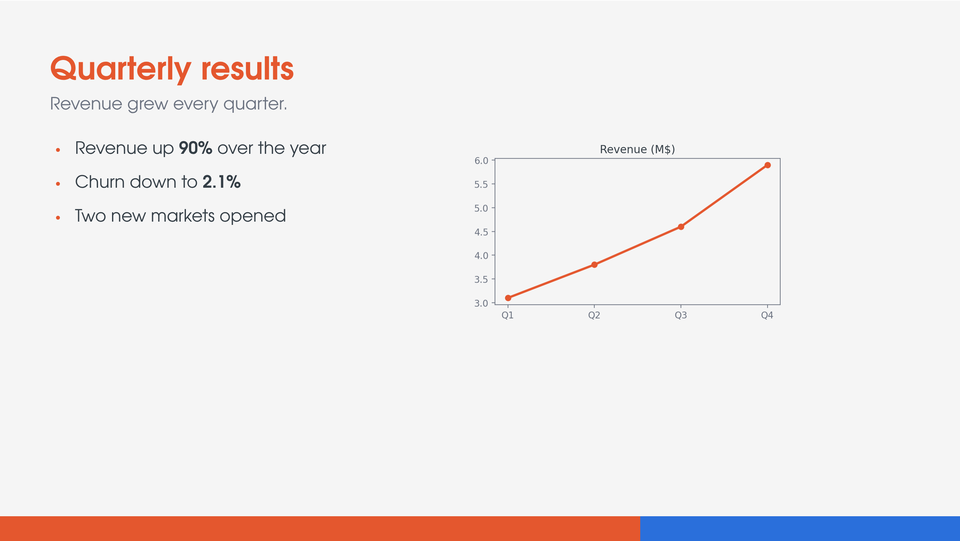
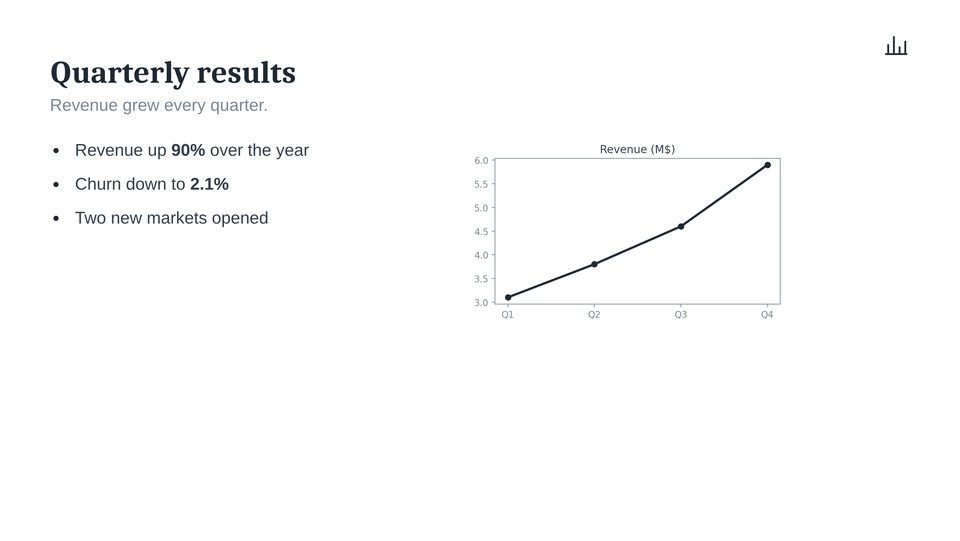
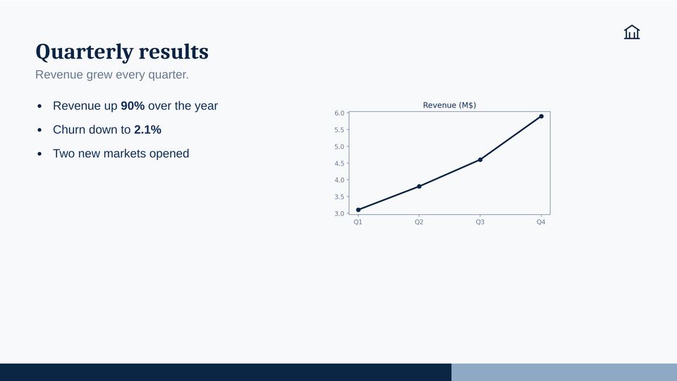
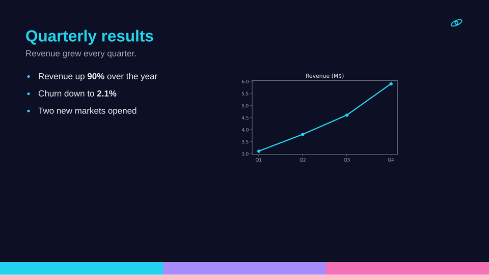
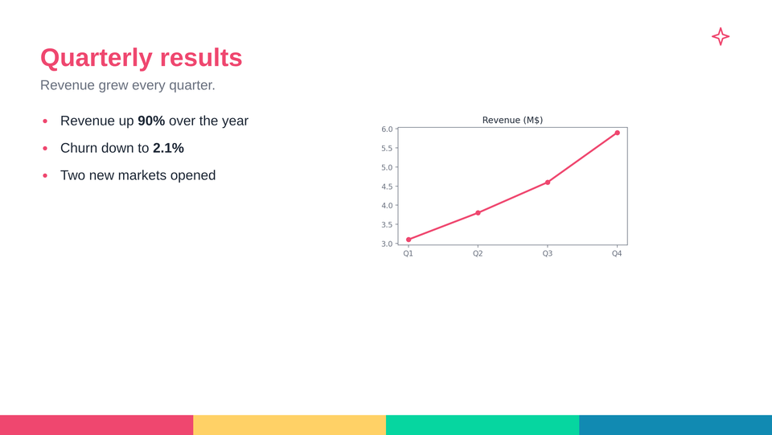
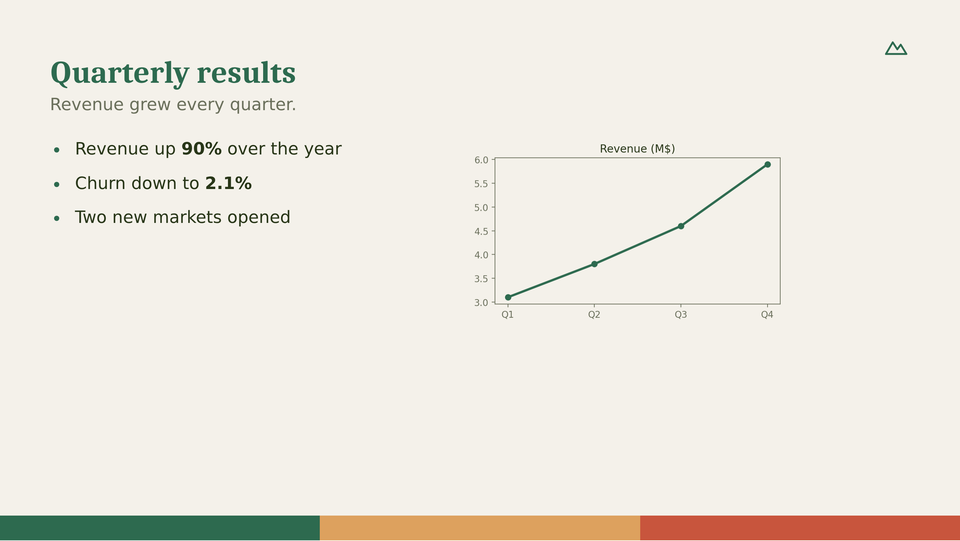
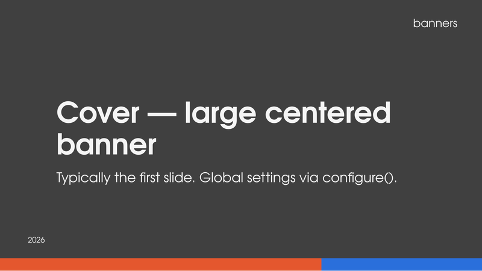
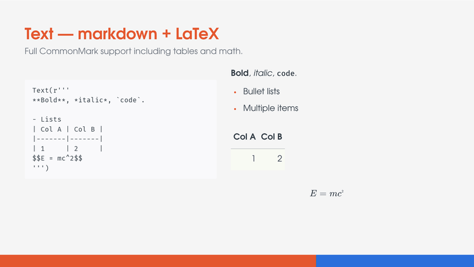
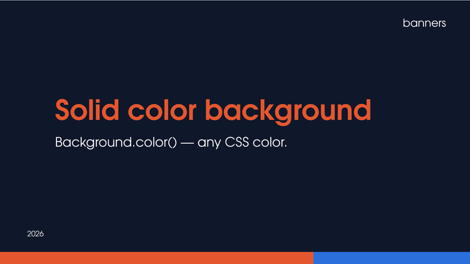

# marimo-banners

[](https://github.com/kascesar/banners/actions/workflows/ci.yml)
[](https://pypi.org/project/marimo-banners/)

**Presentation-grade slides written in Python, inside [marimo](https://marimo.io) notebooks.**

Each slide is a Python object drawn on a fixed 16:9 canvas. Text, plots,
tables, diagrams and click-through animations sit next to the code that
produced them, and one line switches the look of the whole deck.

> **Personal note:** This project is a personal initiative to explore the capabilities of generative AI for developing complete, production-quality software projects — from architecture decisions to implementation, testing, and documentation — using [Claude Code](https://claude.ai/code) as the primary development partner.

## One slide, six templates

The slide below is the same Python object every time; only `configure(template=...)` changes.

<table>
  <tr>
    <td><sub><code>Template()</code></sub><br></td>
    <td><sub><code>EXECUTIVE</code></sub><br></td>
  </tr>
  <tr>
    <td><sub><code>INSTITUTIONAL</code></sub><br></td>
    <td><sub><code>COSMOS</code></sub><br></td>
  </tr>
  <tr>
    <td><sub><code>VIBRANT</code></sub><br></td>
    <td><sub><code>TERRA</code></sub><br></td>
  </tr>
</table>

## Install

```bash
pip install marimo-banners            # or: uv add marimo-banners
pip install "marimo-banners[manim]"   # + animations (needs cairo, pango and ffmpeg)
```

Python 3.11 or newer. Version 0.6 dropped Python 3.10; stay on 0.5.1 there.

## Quick start

```python
from banners import TERRA, Closing, Cover, Section, Text, configure

configure(template=TERRA, team="Analytics Team", date="2026")

Cover(title="Churn Prediction v2", subtitle="Model migration and deployment.")
Section(title="Results", content=[
    Text("**Accuracy** — 91% AUC."),
    Text("**Latency** — p99 under 30 ms."),
])
Closing(title="One framework for all models.")
```

Put each slide at the end of its own marimo cell and open the notebook in
slide mode.

## Showcase

**Slide types and palettes** — `Cover`, `Intro`, `Section`, `Closing`, five palettes or your own colors.



**Content** — Markdown and LaTeX, images, Mermaid diagrams, tables, matplotlib and plotly, animations.



**Backgrounds** — solid colors, gradients and photos, with the text color picked for contrast.



## What's inside

- **A real 16:9 canvas.** Sizes are relative to the slide width, so a deck
  looks the same in a notebook cell and on a projector.
- **Templates = palette + theme + layouts.** Swap the whole look, the colors
  or the fonts with one argument; a single slide can take its own palette.
- **Plots that match the slide.** matplotlib figures take the palette colors
  and a transparent background on their own.
- **Click-through animations.** `FlowAnimation` builds a pipeline diagram node
  by node; `Manim` plays any [Manim](https://www.manim.community) scene, one
  click per step, drawn in the slide colors.
- **Backgrounds with automatic contrast.** Dark photo or light gradient, the
  text stays readable.

## Learn more

- [`example/showcase.py`](example/showcase.py) — every feature, slide by slide.
- [`example/ondas_electromagneticas.py`](example/ondas_electromagneticas.py) — a
  complete deck: Maxwell's equations with an animated derivation.
- API reference: `make docs` builds it in `docs/`.

Licensed under the [GPL-2.0](LICENSE).
