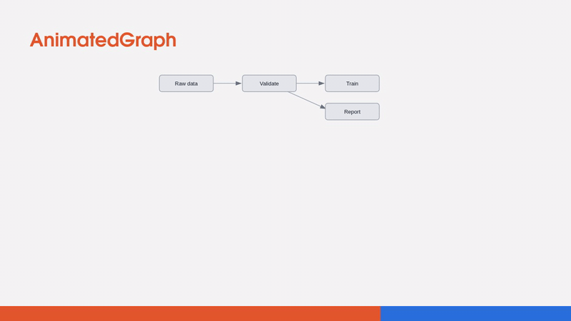

This page covers `AnimatedGraph`, an interactive flowchart for explaining a
process one step at a time.

## Example

```python
from banners import AnimatedGraph, Section

Section(
    title="AnimatedGraph",
    content=[AnimatedGraph("""
graph LR
A[Raw data] --> B[Validate]
B --> C[Train]
B --> D[Report]
""")],
)
```

{width=80%}

## What it accepts

`AnimatedGraph` reads a subset of Mermaid flowchart syntax:

- A first line `graph LR` (left to right) or `graph TD` (top down).
- One edge per line: `A --> B`, with optional labels on the nodes
  (`A[Raw data]`, `B(Round)`, `C{Decision}`) and on the edge
  (`A -->|yes| B`).
- A node on its own line, such as `E[Archive]`, to add a node without edges.

banners parses the diagram and lays out the nodes itself, so the result does
not depend on a browser library.

## Options

| Argument | Default | Meaning |
|---|---|---|
| `diagram` | — | The Mermaid `graph LR` / `graph TD` source. |
| `highlight_color` | `"#ea580c"` | Fill color of a highlighted node. |

## Limits

- It needs a running marimo notebook (`marimo edit` or `marimo run`): the
  clicks are handled by the notebook, so a static HTML export shows an error
  in its place.
- It supports flowcharts only. For other Mermaid diagrams, or for chained
  edges such as `A --> B --> C` on one line, use [`Graph`](graph.qmd).
