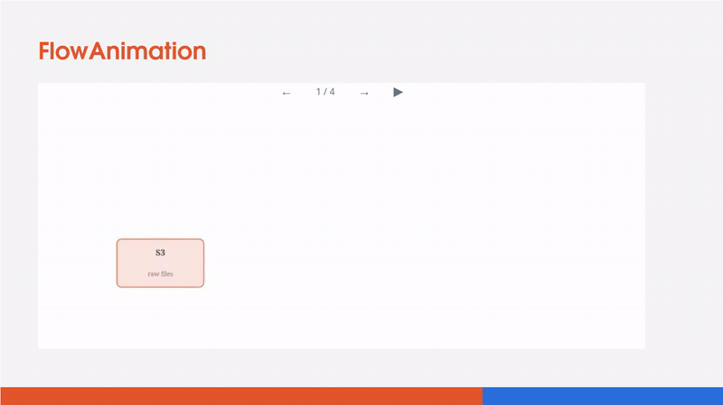

This page covers `FlowAnimation`: its three input formats, its options and
what it needs to run.

## Example

```python
from banners import FlowAnimation, Section

Section(
    title="FlowAnimation",
    content=[FlowAnimation([
        {"name": "S3", "detail": "raw files"},
        {"name": "Glue", "detail": "ETL job"},
        {"name": "Athena", "detail": "SQL"},
        {"name": "Dashboard", "detail": "BI"},
    ])],
)
```

{width=80%}

The player above the animation has back and forward buttons, a step counter
and an autoplay toggle; clicking the animation itself also advances it. Each
step lasts a quarter of a second, and the nodes and arrows take the colors of
the slide's palette.

## Three ways to describe the flow

**A list** gives a chain, left to right:

```python
from banners import FlowAnimation

FlowAnimation(["S3", "Glue", "Athena"])
```

Each node is a name, or a dictionary with a `name` and a `detail` shown under
it.

**A list of lists** gives layers, top down; every node of a layer connects to
every node of the next one:

```python
from banners import FlowAnimation

FlowAnimation([
    ["Ingest"],
    [{"name": "Transform A", "detail": "features"}, {"name": "Transform B", "detail": "filters"}],
    ["Load"],
])
```

**Nodes and edges** give any graph; the layout is computed from the edges:

```python
from banners import FlowAnimation

FlowAnimation(
    nodes=["Ingest A", "Ingest B", "Validate", "Train"],
    edges=[("Ingest A", "Validate"), ("Ingest B", "Validate"), ("Validate", "Train")],
)
```

## Options

| Argument | Default | Meaning |
|---|---|---|
| `nodes` | — | The nodes, in one of the three formats above. |
| `edges` | `None` | `(source, target)` pairs; switches to the graph format. |
| `direction` | `"LR"` for lists and graphs, `"TD"` for layers | `"LR"` (left to right) or `"TD"` (top down). |
| `quality` | `"low"` | Render quality: `"low"`, `"medium"` or `"high"`. |
| `width` | `"100%"` | Maximum width of the player, any CSS value. |
| `autoplay` | `False` | Advance by itself at the end of each step. |
| `palette` | the slide's palette | Colors of the animation. |

## Requirements

`FlowAnimation` is rendered by [Manim](manim.qmd), so it needs the `manim`
extra and its system libraries. The first render of a flow takes a few
seconds; later renders come from a cache on disk (see
[Cache and speed](../howto/cache.qmd)).
