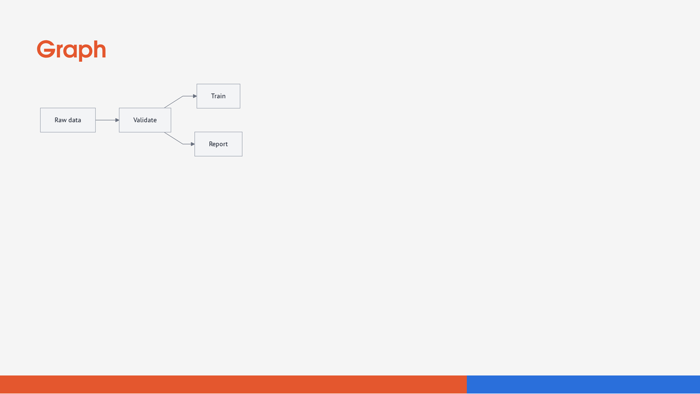

This page covers `Graph`, the element for diagrams written as text.

## Example

```python
from banners import Graph, Section

Section(
    title="Graph",
    content=[Graph("graph LR\n  A[Raw data] --> B[Validate]\n  B --> C[Train]\n  B --> D[Report]")],
)
```

{width=80%}

`Graph(diagram)` takes [Mermaid](https://mermaid.js.org) source and draws it
with marimo's Mermaid support. Any Mermaid diagram type works: flowcharts
(`graph LR`, `graph TD`), sequence diagrams, state diagrams and others.

## Multi-line diagrams

A triple-quoted string keeps the diagram readable:

```python
from banners import Graph

Graph("""
graph TD
    A[Ingest] --> B{Valid?}
    B -- yes --> C[Load]
    B -- no --> D[Quarantine]
""")
```

banners adds a neutral Mermaid theme unless the diagram sets its own with a
`%%{init: …}%%` line.

## Graph or AnimatedGraph

`Graph` is static and supports every Mermaid feature. For a flowchart that the
audience explores by clicking on its nodes, use
[`AnimatedGraph`](animated-graph.qmd).
