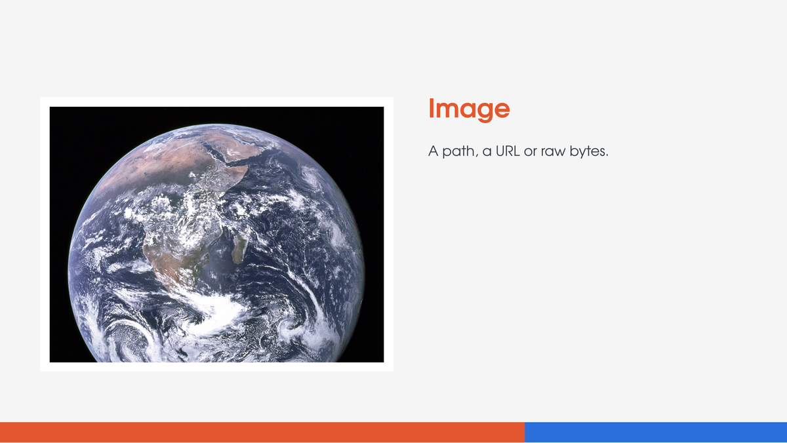

This page covers `Image`, the element for pictures inside a slide.

## Example

```python
from banners import Image, Section, Text

Section(
    title="Image",
    content=[
        Image("https://commons.wikimedia.org/wiki/Special:FilePath/The_Earth_seen_from_Apollo_17.jpg?width=1600"),
        Text("A path, a URL or raw bytes."),
    ],
)
```

{width=80%}

An image followed by text takes the [visual-and-text layout](../look/layouts.qmd):
the picture on the left, the explanation on the right.

## Sources

| Source | Example | Notes |
|---|---|---|
| File path | `Image("img/architecture.png")` | Relative to where marimo runs. |
| Bytes | `Image(Path("img/architecture.png").read_bytes())` | Travels with the notebook output; useful when the deck is exported. |
| URL | `Image("https://…/photo.jpg")` | Loaded from the web. |

## Options

| Argument | Default | Meaning |
|---|---|---|
| `src` | — | The picture: a path, bytes or a URL. |
| `width` | `"100%"` | CSS width, such as `"80%"` or `"400px"`. |
| `alt` | `""` | Text read by screen readers and shown if the picture fails to load. |

For a photo that fills half of the slide, the `image=` argument of
[`Section`](../slides/section.qmd) gives a cleaner result than an `Image` in
the content.
