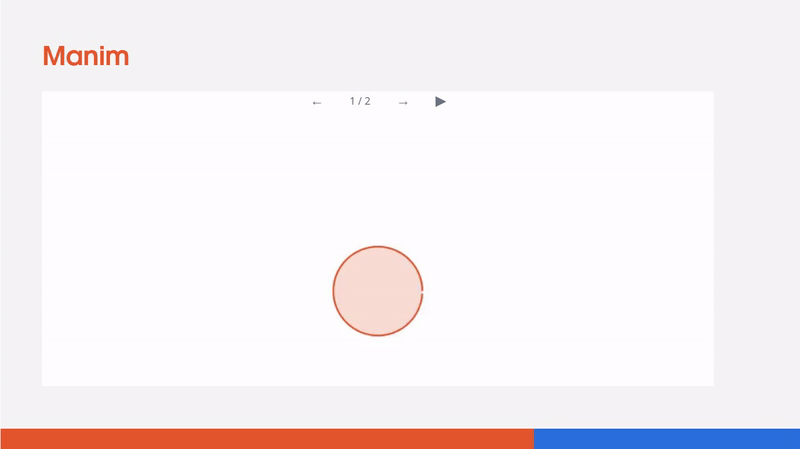

This page covers `Manim`: installing it, the three ways to show a scene, and
how the scene follows the slide colors.

## Install

```bash
pip install "marimo-banners[manim]"
```

Manim draws with cairo and pango and encodes video with ffmpeg, so the system
needs those libraries:

::: {.panel-tabset}
## Ubuntu / Debian

```bash
sudo apt install python3-dev libpango1.0-dev pkg-config libcairo2-dev libx11-dev libgl1-mesa-dev ffmpeg
```

## Fedora

```bash
sudo dnf install gcc-c++ python3-devel pkgconf-pkg-config cairo-devel pango-devel libX11-devel mesa-libGL-devel ffmpeg
```
:::

Scenes that write formulas with `MathTex` also need a LaTeX installation with
the `standalone` package and `dvisvgm` (on Fedora, `texlive-standalone` and
`texlive-dvisvgm`).

## A click-through scene

With `interactive=True`, each `self.next_section()` of the scene becomes one
step, and each click on the player shows the next one:

```python
from banners import ORANGE, Manim, Section
from manim import Circle, Create, Scene, Square, Transform

class ShapeScene(Scene):
    def construct(self):
        self.next_section("circle")
        shape = Circle(color=ORANGE.primary, fill_opacity=0.2)
        self.play(Create(shape), run_time=0.4)
        self.next_section("square")
        self.play(Transform(shape, Square(color=ORANGE.secondary, fill_opacity=0.2)), run_time=0.4)

Section(title="Manim", content=[Manim(ShapeScene, interactive=True)])
```

{width=80%}

Pass the scene class, not an instance. [A click-through Manim
scene](../howto/manim-scene.qmd) explains how to write scenes that present
well.

## Still images and videos

Without `interactive`, the whole scene plays as one piece:

| `format` | Shown as |
|---|---|
| `"gif"` (default) | An animated image that loops. |
| `"png"` | The last frame, as a still image. |
| `"mp4"` | A video with controls; `autoplay=True` plays it muted and in a loop. |

## Colors

The scene is drawn on the slide's `palette.panel` color, so it blends into the
slide, and the player buttons use `muted` and `primary`. A scene that sets
`self.camera.background_color` keeps its own background. Shapes and text keep
the colors the scene gives them; importing a palette (as `ORANGE` above) lets
a scene use the deck colors.

## Options

| Argument | Default | Meaning |
|---|---|---|
| `scene` | — | A Manim `Scene` subclass, or a function that returns one. |
| `format` | `"gif"` | `"gif"`, `"png"` or `"mp4"` when not interactive. |
| `quality` | `"low"` | `"low"`, `"medium"` or `"high"`; higher is sharper and slower. |
| `interactive` | `False` | One step per `next_section()`, advanced by clicks. |
| `width` | `"100%"` | Maximum width of the player. |
| `autoplay` | `False` | Interactive: advance by itself; static mp4: play muted in a loop. |
| `palette` | the slide's palette | Background and player colors. |

## A ready-made scene

`banners.scenes.PipelineScene` is a data-pipeline animation in seven steps
that follows the palette:

```python
from banners import Manim, Section
from banners.scenes import PipelineScene

Section(title="Our pipeline", content=[Manim(PipelineScene, interactive=True)])
```

Renders are cached on disk, so a scene is rendered once; see
[Cache and speed](../howto/cache.qmd).
