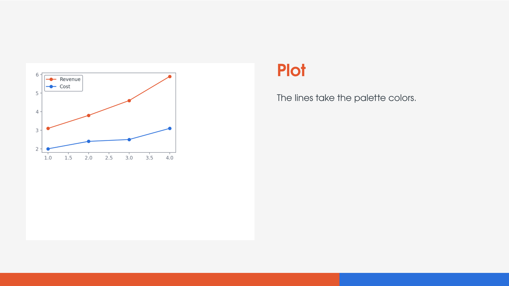

This page covers `Plot`, how a figure takes the colors of the slide, and when
it does not.

## Example

```python
import matplotlib.pyplot as plt
from banners import Plot, Section, Text

fig, ax = plt.subplots(figsize=(5, 3))
ax.plot([1, 2, 3, 4], [3.1, 3.8, 4.6, 5.9], marker="o", label="Revenue")
ax.plot([1, 2, 3, 4], [2.0, 2.4, 2.5, 3.1], marker="o", label="Cost")
ax.legend()
Section(title="Plot", content=[Plot(fig), Text("The lines take the palette colors.")])
```

The same figure on two slides with different palettes:

::: {layout-ncol=2}



:::

## How a figure follows the palette

When a matplotlib figure is placed on a slide, banners restyles a copy of it
(your figure is not modified):

- The figure and axes backgrounds become transparent, so the slide shows
  through.
- Lines, bars and markers drawn with matplotlib's automatic colors take the
  palette series: `section_colors`, or `primary` and `secondary`.
- Titles, axis labels and legend text take `palette.text`; ticks, spines and
  grid lines take `palette.muted`; the legend box takes `palette.panel`.

Colors you set by hand (`color="#3b82f6"`) are kept. To keep a figure exactly
as drawn, set its colors explicitly.

## plotly

`Plot` also accepts a plotly figure and detects the library by itself. plotly
figures are shown as they are, without the palette restyling:

```python
# fragment: needs plotly installed.
import plotly.express as px
from banners import Plot, Section

fig = px.line(x=[1, 2, 3, 4], y=[3.1, 3.8, 4.6, 5.9])
Section(title="Plotly", content=[Plot(fig)])
```

A figure that is neither matplotlib nor plotly raises a `TypeError` when the
slide is drawn.
