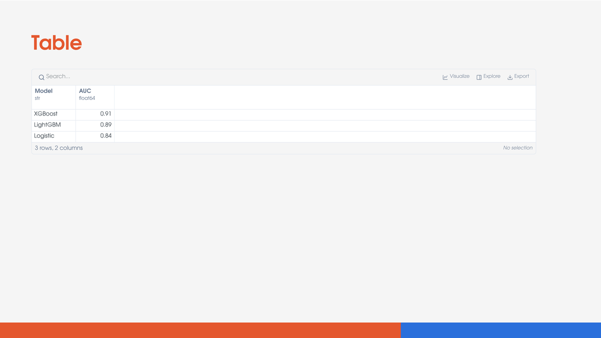

This page covers `Table`, the element for tabular data.

## Example

```python
import pandas as pd
from banners import Section, Table

df = pd.DataFrame({"Model": ["XGBoost", "LightGBM", "Logistic"], "AUC": [0.91, 0.89, 0.84]})
Section(title="Table", content=[Table(df)])
```

{width=80%}

`Table(df)` shows the DataFrame with marimo's table component, which adds a
search box, column types and export buttons.

## Limits

- The marimo table has its own font sizes, so it does not grow with the slide
  the way text does. Keep tables short (a handful of rows and columns) so they
  read well full screen.
- For a few figures, a markdown table inside a [`Text`](text.qmd) follows the
  slide's font and colors:

```python
from banners import Section, Text

Section(
    title="Model comparison",
    content=[Text("| Model | AUC |\n|---|---|\n| XGBoost | 0.91 |\n| Logistic | 0.84 |")],
)
```

pandas is not a dependency of banners; install it to use `Table`.
