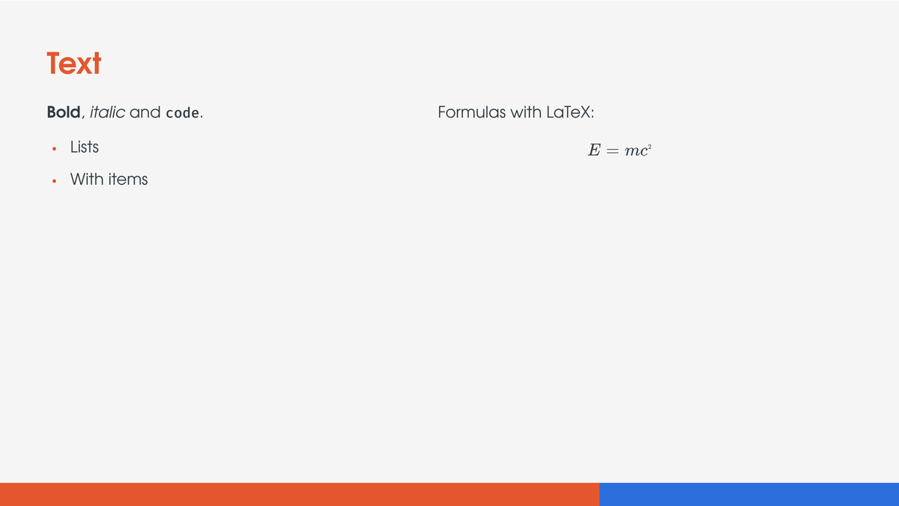

This page covers `Text`, the element for words, lists and formulas.

## Example

```python
from banners import Section, Text

Section(
    title="Text",
    content=[
        Text("**Bold**, *italic* and `code`.\n\n- Lists\n- With items"),
        Text("Formulas with LaTeX:\n\n$$E = mc^2$$"),
    ],
)
```

{width=80%}

## What it accepts

`Text(body)` takes a markdown string: paragraphs, **bold**, *italic*, `code`,
lists, links, tables and code blocks. Formulas use LaTeX between `$…$`
(inline) or `$$…$$` (on their own line). In Python strings with backslashes,
such as LaTeX commands, a raw string avoids doubling them:

```python
from banners import Text

Text(r"The wave equation: $\nabla^2 \mathbf{E} = \frac{1}{c^2}\frac{\partial^2 \mathbf{E}}{\partial t^2}$")
```

## How it looks on a slide

The template sets the font, the size and the color of the text, so a `Text`
looks the same in every slide of the deck. Each `Text` in `content` becomes a
column; a list of three `Text` elements gives three columns side by side.
Inline code takes the color of the slide text, so it stays readable on dark
backgrounds; code blocks keep their own light box.

A common pattern is a bold lead followed by a dash and the detail, one `Text`
per idea:

```python
from banners import Section, Text

Section(
    title="Results",
    content=[
        Text("**Accuracy** — 91% AUC on the test set."),
        Text("**Latency** — p99 under 30 ms."),
    ],
)
```
