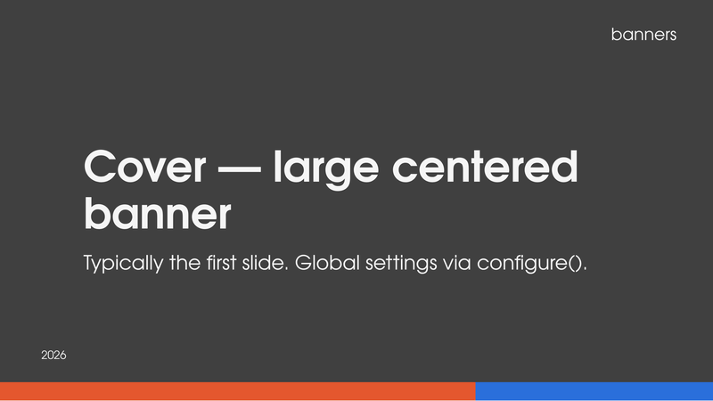
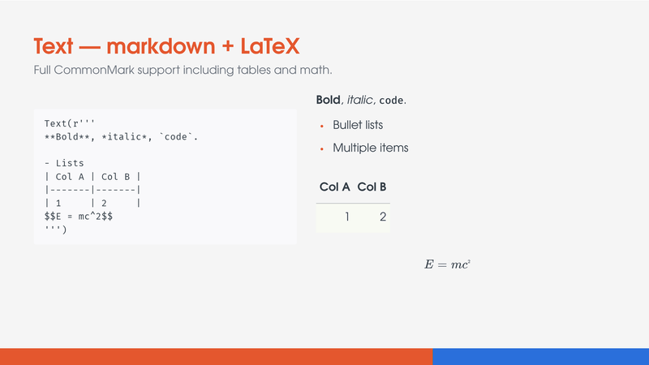
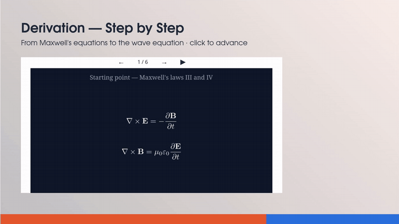

The repository has two example decks in the `example/` folder. Clone it to
run them:

```bash
git clone https://github.com/kascesar/banners
cd banners
uv sync --extra dev
```

## Showcase

`example/showcase.py` walks through every feature, one slide at a time, with
the code of each slide next to it.

::: {layout-ncol=1}





:::

```bash
uv run marimo edit example/showcase.py
```

## Electromagnetic waves

`example/ondas_electromagneticas.py` is a complete talk: Maxwell's equations,
an animated step-by-step derivation of the wave equation, and a plot of the
resulting wave. It needs the `manim` extra and LaTeX.



```bash
uv run marimo edit example/ondas_electromagneticas.py
```
