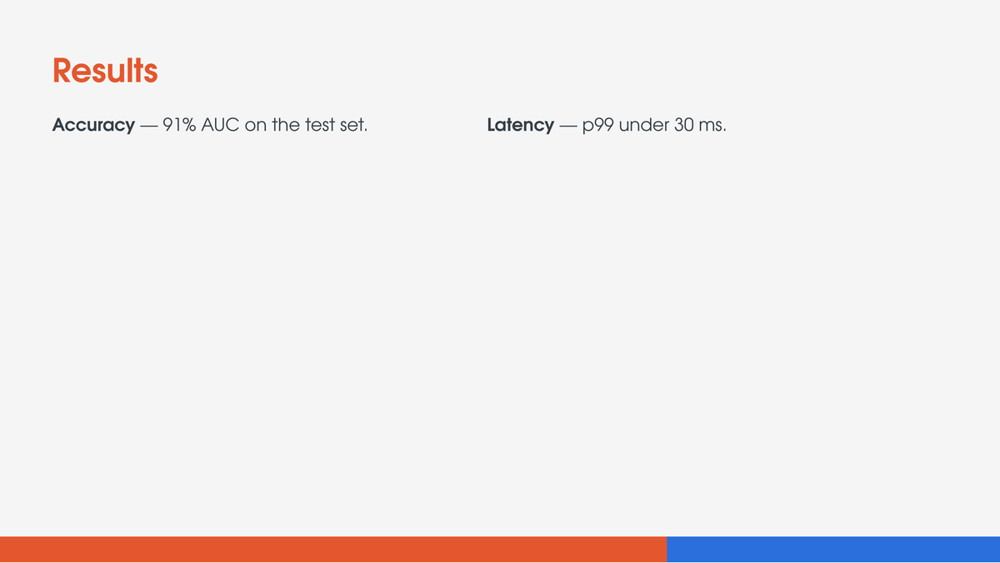
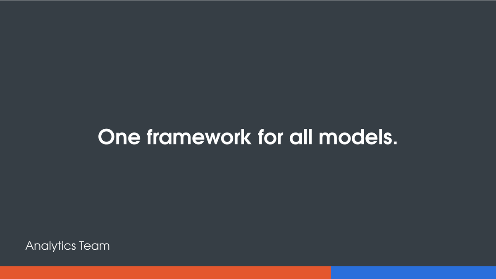

This page takes you from installing banners to presenting a three-slide deck
full screen. It covers installation, the first notebook, the three most common
slide types and marimo's slide view.

## Install

banners needs Python 3.11 or newer. It installs marimo with it.

::: {.panel-tabset}
## pip

```bash
pip install marimo-banners
```

## uv

```bash
uv add marimo-banners
```
:::

The animated elements (`FlowAnimation`, `Manim`) need an extra and a few
system libraries; the [Manim page](content/manim.qmd) lists them. Nothing on
this page needs them.

## Create a notebook

marimo notebooks are Python files. Create one and open it in the editor:

```bash
marimo edit deck.py
```

## Write three slides

Write each block below in its own cell. A cell displays the value of its last
expression, so each cell shows one slide.

```python
# Cell 1: settings shared by every slide.
from banners import Closing, Cover, Section, Text, configure

configure(team="Analytics Team", date="2026")

# Cell 2: the cover opens the talk.
Cover(title="Churn Prediction v2", subtitle="Model migration and deployment.")

# Cell 3: a section holds the content.
Section(
    title="Results",
    content=[
        Text("**Accuracy** — 91% AUC on the test set."),
        Text("**Latency** — p99 under 30 ms."),
    ],
)

# Cell 4: the closing slide carries the final message.
Closing(title="One framework for all models.")
```

::: {layout-ncol=3}





:::

The three slides that the cells above display.

`configure()` stores the values that every slide shares, such as the team name
and the date, so the slides do not repeat them. The [Slides](slides/cover.qmd)
pages describe each slide type and its options.

::: {.callout-note}
## Cell order matters

A `Section` takes its number (`01`, `02`, …) when its cell runs, so sections
are numbered in the order of the notebook cells, and calling `configure()`
starts the count again. The number picks the color of each section in
palettes that have one color per section.
:::

## Show it as slides

marimo can show a notebook as slides, one cell per slide, with the code
hidden:

1. In the editor, open the app view (the preview button at the bottom right,
   or <kbd>Ctrl</kbd>/<kbd>Cmd</kbd> + <kbd>.</kbd>).
2. In the layout menu of the app view, choose **Slides**. marimo saves this
   choice in a `layouts/` folder next to the notebook.
3. To present, run the notebook as an app and press the **Fullscreen**
   button at the bottom right of the slides; the arrow keys then move between
   slides:

```bash
marimo run deck.py
```

[Present full screen](howto/present.qmd) covers the details, such as hiding
cells that are not slides.

## Change the look

The deck above uses the default template. One argument changes it:

```python
from banners import COSMOS, configure

configure(template=COSMOS)
```

Every slide created after this call takes the dark COSMOS look. The
[Templates](look/templates.qmd) page shows all of them, and the next pages of
the guide explain how to change colors, fonts and backgrounds.
