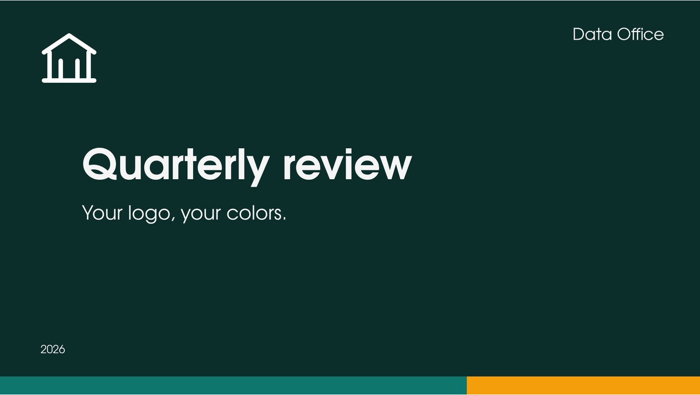

This guide builds a complete template for an organization: logos, colors,
fonts and photos, kept in one file that every deck imports.

## The template

```python
from banners import Cover, Palette, Template, configure, icon

corp = Template(
    palette=Palette(primary="#0f766e", secondary="#f59e0b", dark="#0b2e2b"),
    logo_on_dark=icon("building", color="#ffffff"),
    mark=icon("building", color="#0f766e"),
)
configure(template=corp, team="Data Office", date="2026")
Cover(title="Quarterly review", subtitle="Your logo, your colors.")
```

{width=80%}

The example uses a built-in icon as a stand-in logo. With real artwork, the
logo options take a URL, a file path or raw bytes:

| Option | Shown on | Tip |
|---|---|---|
| `logo_on_dark` | Cover and closing slides (dark backgrounds). | A white or light version of the logo. |
| `logo_on_light` | Content slides (light backgrounds). | The full-color logo. Without `logo_on_dark`, banners draws this one in white on dark slides. |
| `mark` | Top-right corner of content slides. | The symbol alone, without the name. |
| `closing_image` | Next to the closing title. | A mascot, a product picture or the symbol. |

The logo keeps its proportions and stays within its area, so a square logo
and a wide one both fit above the title.

## Colors and fonts

Write the brand colors into the palette roles (see
[Palettes](../look/palettes.qmd)) and the brand fonts into a theme (see
[Themes](../look/themes.qmd)):

```python
from banners import Palette, Template, Theme

corp = Template(
    palette=Palette(
        primary="#0f766e",        # titles and the bar
        secondary="#f59e0b",      # end of the bar
        dark="#0b2e2b",           # cover background
        closing_bg="#0b2e2b",     # closing background
        section_colors=("#0f766e", "#f59e0b", "#2563eb"),
    ),
    theme=Theme(font="'Inter', 'Helvetica Neue', sans-serif", heading_font="'Inter', sans-serif"),
    auto_contrast=False,          # keep the exact brand colors
)
```

`auto_contrast=False` keeps the title colors exactly as given, even where they
would be hard to read; leave it on unless the brand guide requires exact
colors.

## Photos

`cover_image` and `divider_image` give every cover and divider a photo. Use
pictures you are allowed to publish: your organization's own, or public-domain
ones such as those on Wikimedia Commons. A URL is loaded by the browser when
the slide is shown; a path or bytes are embedded in the slide.

## Share it across decks

Put the template in a Python file, for example `ourbrand.py`, next to the
notebooks or in a package your team installs:

```python
# fragment: ourbrand.py
from banners import Palette, Template

TEMPLATE = Template(palette=Palette(primary="#0f766e", secondary="#f59e0b"))
```

Each deck then starts with:

```python
# fragment: first cell of every deck.
from banners import configure
from ourbrand import TEMPLATE

configure(template=TEMPLATE, team="Data Office", date="2026")
```

::: {.callout-important}
## Logos are trademarks

A logo belongs to its organization, and its brand rules decide who may use it
and how. Use your organization's logo for its own presentations, follow its
brand guide, and do not publish a template with another organization's logo.
:::
