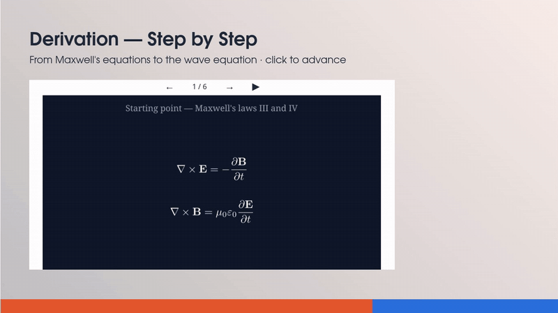

banners is a Python library for building slide decks in
[marimo](https://marimo.io) notebooks. Each slide is a Python object drawn on a
fixed 16:9 canvas, so the text, plots, tables, diagrams and animations of a
talk sit next to the code that produced them, and the deck keeps its
proportions from a notebook cell to a projector.

## One slide, six looks

The same slide drawn with each built-in template. Changing the template is one
line of code; the slides themselves do not change.

::: {layout-ncol=2}


:::

## Animations that advance with each click

A [Manim](https://www.manim.community) scene can run step by step inside a
slide: each click shows the next step, drawn in the colors of the slide.



## Install

```bash
pip install marimo-banners
```

banners needs Python 3.11 or newer. Animations need the `manim` extra; the
[Manim page](content/manim.qmd) explains it.

## A deck in a few lines

```python
from banners import TERRA, Closing, Cover, Section, Text, configure

configure(template=TERRA, team="Analytics Team", date="2026")

Cover(title="Churn Prediction v2", subtitle="Model migration and deployment.")
Section(title="Results", content=[Text("**Accuracy** — 91% AUC.")])
Closing(title="One framework for all models.")
```

In a marimo notebook each slide goes at the end of its own cell, where marimo
displays it. [Get started](get-started.qmd) walks through it, from installation
to presenting full screen.

## Where to go next

- [Get started](get-started.qmd): a first deck in five minutes.
- [Look and feel](look/templates.qmd): templates, palettes, themes, layouts and backgrounds.
- [Slides](slides/cover.qmd): the four slide types and their options.
- [Content](content/text.qmd): text, images, tables, plots, diagrams and animations.
- [How-to guides](howto/present.qmd): presenting, your organization's template, Manim scenes.
