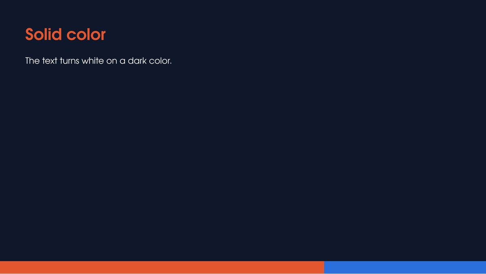
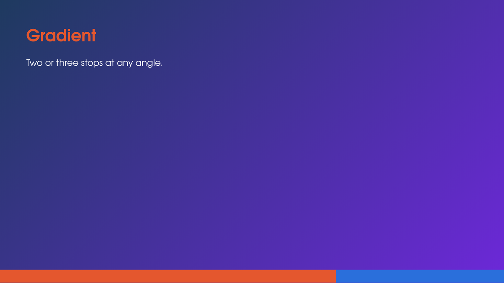
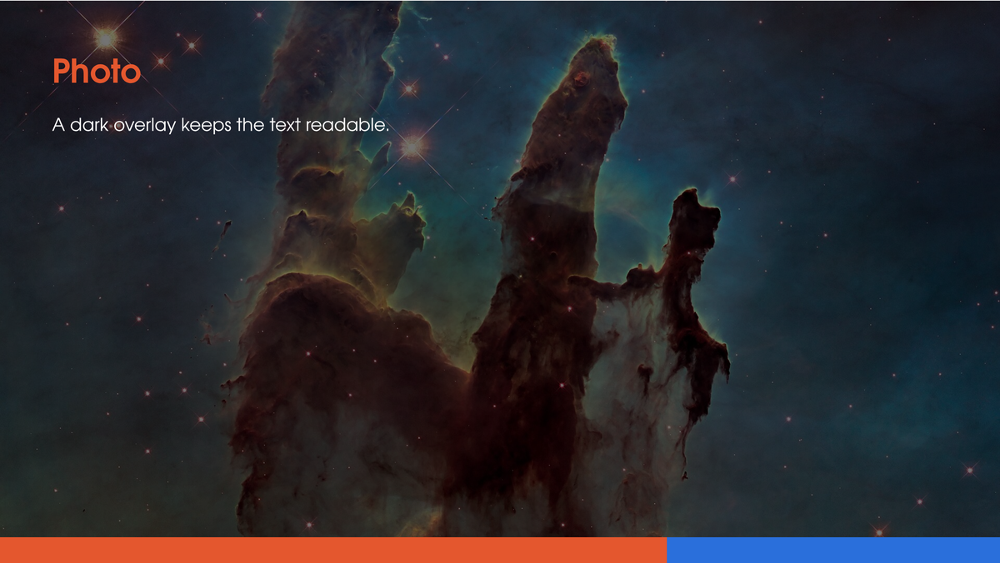

This page covers the three kinds of background, how the text color adapts to
them, and how to set a background for one slide or for the whole deck.

## Three kinds

`Background` has one constructor per kind:

| Constructor | Paints |
|---|---|
| `Background.color(c)` | One CSS color. |
| `Background.gradient(start, end, mid=None, angle=135)` | A linear gradient of two or three colors, at an angle in degrees. |
| `Background.image(src, overlay="rgba(0,0,0,0.55)")` | A photo from a URL, a file path or bytes, under a dark overlay. |

```python
from banners import Background, Section, Text

Section(
    title="Solid color",
    content=[Text("The text turns white on a dark color.")],
    background=Background.color("#0f172a"),
)
```

```python
from banners import Background, Section, Text

Section(
    title="Gradient",
    content=[Text("Two or three stops at any angle.")],
    background=Background.gradient("#1e3a5f", "#6d28d9", angle=135),
)
```

```python
# fragment: downloads the photo when the background is created.
from banners import Background, Section, Text

Section(
    title="Photo",
    content=[Text("A dark overlay keeps the text readable.")],
    background=Background.image(
        "https://commons.wikimedia.org/wiki/Special:FilePath/"
        "Pillars_of_creation_2014_HST_WFC3-UVIS_full-res_denoised.jpg?width=1600"
    ),
)
```

::: {layout-ncol=3}





:::

## The text adapts

banners reads the first color of the background and measures how light it is.
On a dark background the text and subtitles turn white; on a light one they
stay dark. That is why a dark gradient needs no change to the palette. The
title keeps the palette's `primary` color unless it would be hard to read.

For a photo, the overlay decides: the default dark overlay makes the text
white. `overlay=None` removes it; banners then cannot measure the photo, so the
text keeps the palette colors, and a dark photo may need a palette with light
text.

## One slide or the whole deck

`background=` on a slide paints that slide. `configure(background=...)` paints
every slide that does not set its own:

```python
from banners import Background, configure

configure(background=Background.gradient("#0f172a", "#1e3a5f"))
```

A photo given by URL is downloaded once, when the background is created, and
embedded in the slides. The download checks the server's certificate; a
failed download raises an error instead of producing a blank slide.
