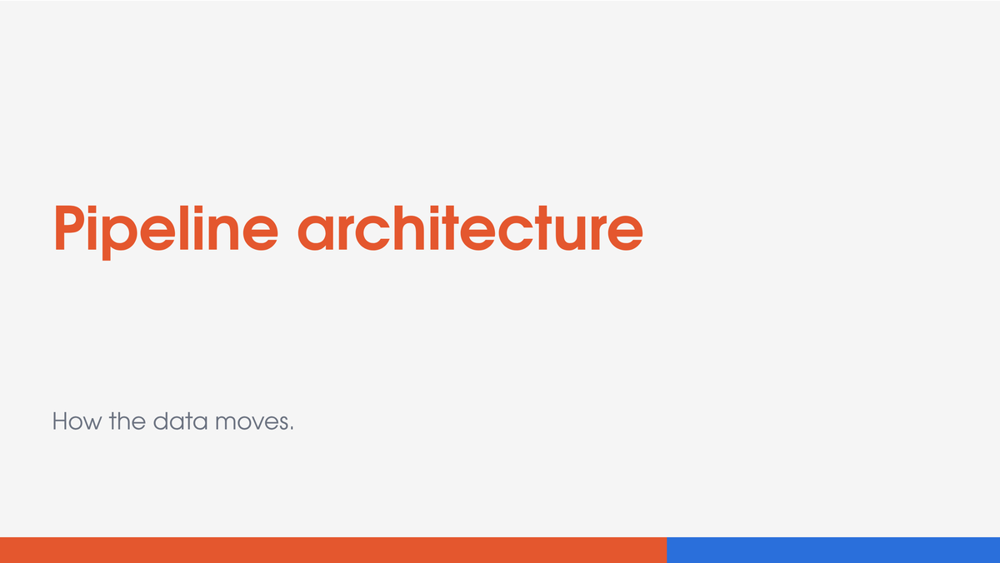
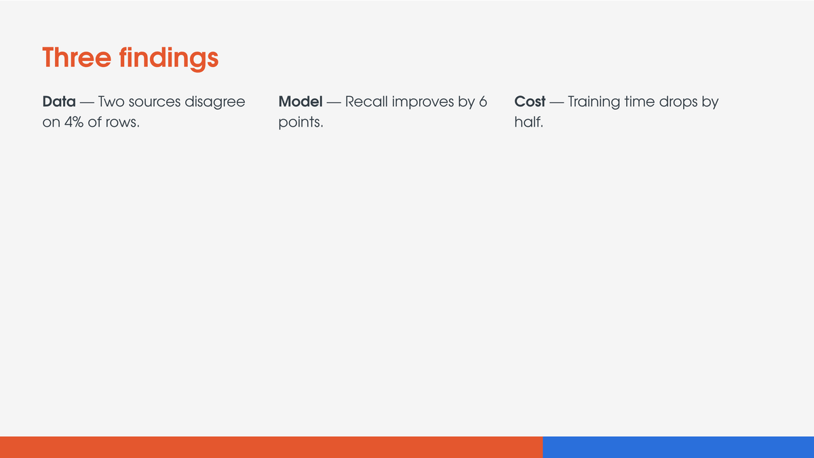
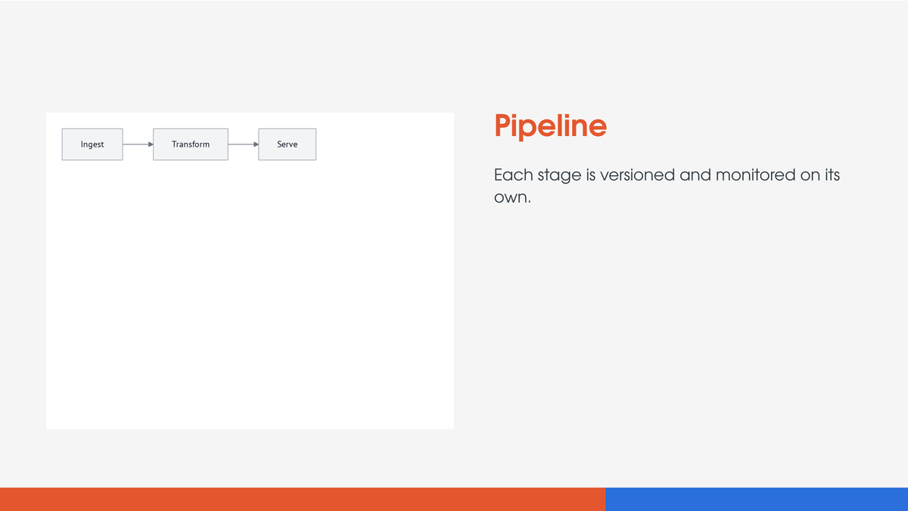
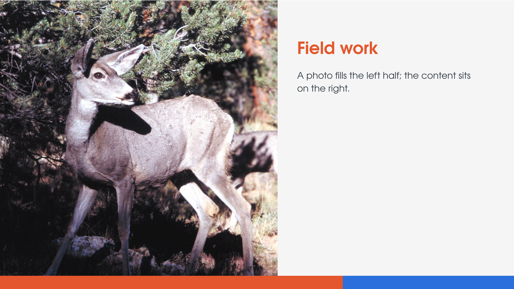

This page covers how banners picks the layout of each slide. There is no
layout argument: the template decides from the kind of slide and from what
you put in it, so the same code gives consistent slides across a deck.

## The rules

| Slide | Layout |
|---|---|
| `Cover()` | Dark cover with the logo, the title in the primary color, subtitle and date. |
| `Cover(image=...)` | Photo cover, with the title over the picture. |
| `Intro()` | Large title in the left column, content in columns on the right. |
| `Section()` without content | Divider: title, subtitle and a photo or a large icon. |
| `Section(content=[visual, Text(...)])` | The visual on the left, title and text on the right. |
| `Section(content=..., image=...)` | Photo on the left half, title and content on the right. |
| `Section(content=...)` otherwise | Title on top, content in columns below. |
| `Closing()` | Closing background with the title, an optional row of figures and the team. |

A *visual* is a plot, a diagram, a table, an image or an animation; text is
`Text`.

## A divider

A `Section` with no content separates the parts of a talk:

```python
from banners import Section

Section(title="Pipeline architecture", subtitle="How the data moves.")
```

{width=70%}

## Content in columns

Several `Text` elements sit side by side, one column each:

```python
from banners import Section, Text

Section(
    title="Three findings",
    content=[
        Text("**Data** — Two sources disagree on 4% of rows."),
        Text("**Model** — Recall improves by 6 points."),
        Text("**Cost** — Training time drops by half."),
    ],
)
```

{width=70%}

## A visual next to its explanation

A visual followed by text puts the visual on the left and the explanation on
the right:

```python
from banners import Graph, Section, Text

Section(
    title="Pipeline",
    content=[
        Graph("graph LR\n  A[Ingest] --> B[Transform] --> C[Serve]"),
        Text("Each stage is versioned and monitored on its own."),
    ],
)
```

{width=70%}

## A photo next to the content

`image=` puts a photo on the left half:

```python
from banners import Section, Text

Section(
    title="Field work",
    content=[Text("A photo fills the left half; the content sits on the right.")],
    image="https://commons.wikimedia.org/wiki/Special:FilePath/Grand_Canyon_National_Park_GRCA9857.jpg?width=1600",
)
```

{width=70%}

## The 16:9 canvas

Every layout places its parts on a fixed 16:9 canvas, with positions and font
sizes relative to the slide width. A slide therefore looks the same in a
notebook cell, in a browser window and full screen: only its size changes.
