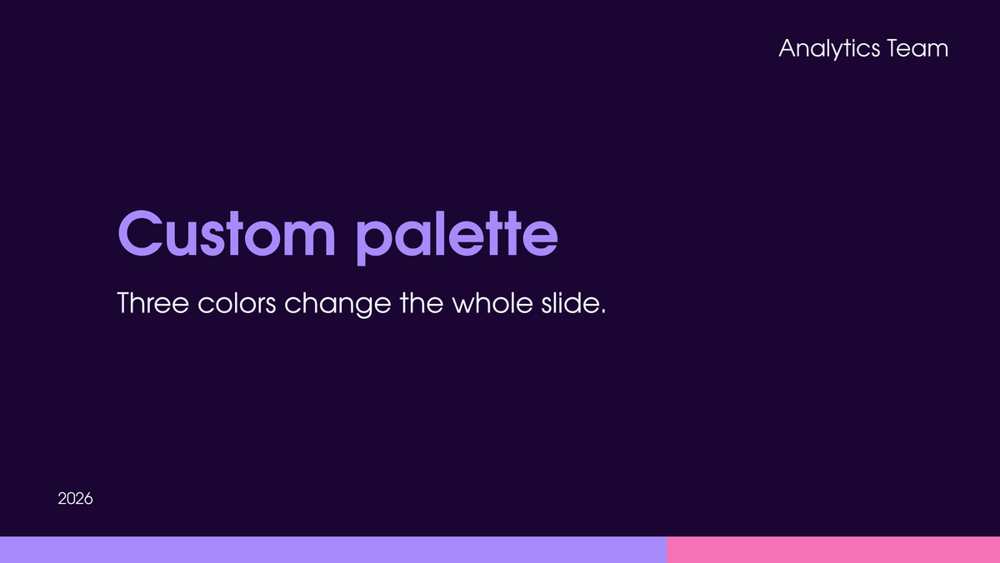
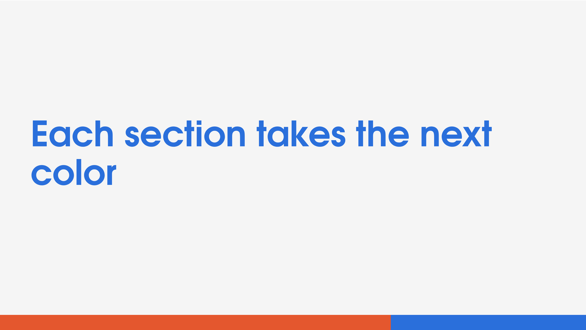

This page covers the color roles of a palette, the five built-in palettes, how
to make your own, and which palette wins when several are set.

## Colors by role

A `Palette` does not list "the colors of the brand"; it says what each color is
for. The template paints each part of a slide with the color of its role:

| Role | Default | Paints |
|---|---|---|
| `primary` | <span style="color:#e4572e">■</span> `#e4572e` | Titles and the main segment of the bottom bar. |
| `secondary` | <span style="color:#2a6fdb">■</span> `#2a6fdb` | The end segment of the bottom bar. |
| `dark` | <span style="color:#404040">■</span> `#404040` | Background of the cover and of the logo-only closing slide. |
| `closing_bg` | <span style="color:#363e45">■</span> `#363e45` | Background of the closing slide. |
| `light` | <span style="color:#f5f5f5">■</span> `#f5f5f5` | Background of dividers and content slides. |
| `text` | <span style="color:#343e46">■</span> `#343e46` | Body text on light backgrounds. |
| `muted` | <span style="color:#6b7280">■</span> `#6b7280` | Subtitles, labels and captions on light backgrounds. |
| `on_dark` | <span style="color:#f5f5f5;background:#404040">■</span> `#f5f5f5` | Text on dark backgrounds. |
| `panel` | `#ffffff` | Background of the box that holds a chart or an animation. |

Three optional roles add variety:

- `section_colors`: colors that `Section` slides take in turn by their number
  (section 01 the first, 02 the second, and so on).
- `bar_colors`: colors of the bottom bar in equal segments, instead of
  `primary` and `secondary`.
- `icon_color`: color of named icons; by default they take the title color.

Plots and animations on a slide also follow the palette: their series use
`section_colors` (or `primary` and `secondary`), their labels use `text` and
`muted`, and their background is `panel`. See [Plot](../content/plot.qmd) and
[Manim](../content/manim.qmd).

## The built-in palettes

banners ships five palettes. `ORANGE` is the default one.

::: {layout-ncol=3}


:::

## Your own palette

Create a `Palette` with the roles you want to change; the others keep their
default value:

```python
from banners import Cover, Palette

brand = Palette(primary="#a78bfa", secondary="#f472b6", dark="#1a0533")
Cover(title="Custom palette", subtitle="Three colors change the whole slide.", palette=brand)
```

{width=70%}

`section_colors` gives each section its own color:

```python
from banners import Palette, Section

rainbow = Palette(section_colors=("#e4572e", "#2a6fdb", "#2e9e5b"))
Section(title="Each section takes the next color", number="02", palette=rainbow)
```

{width=70%}

## Where a palette is set, and which one wins

A palette can be set in three places. When more than one is set, the most
specific one wins:

1. **On a slide**, with `palette=`: only that slide.
2. **For the deck**, with `configure(palette=...)`: every slide after the call.
3. **In the template**, with `Template(palette=...)`: the default.

```python
from banners import BLUE, GREEN, Section, configure

configure(palette=BLUE)                        # every slide is blue...
Section(title="Highlights", palette=GREEN)     # ...except this one
```

A palette always replaces the one below it as a whole: the roles are not
mixed. `Palette(primary="#0f766e")` keeps the default values for every other
role, not the values of the template's palette.

::: {.callout-tip}
## Readable titles on any background

When a title color would be hard to read on its background (a contrast ratio
under 3:1), the template uses a readable color instead. To keep exact brand
colors, create the template with `auto_contrast=False`.
:::
