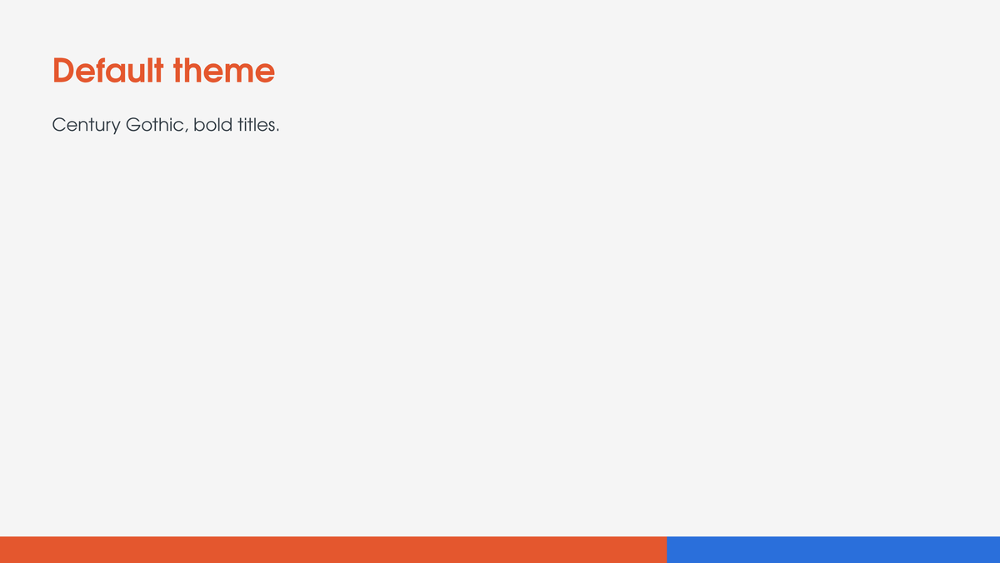
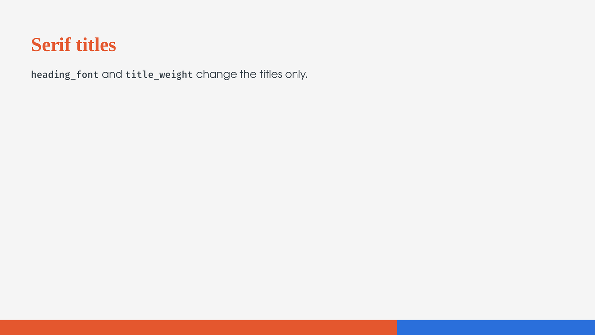

This page covers the five settings of a `Theme` and where to set them. Colors
are not part of a theme; they belong to the [palette](palettes.qmd).

## The settings

| Setting | Default | What it changes |
|---|---|---|
| `font` | Century Gothic and similar geometric fonts | Every text of the slide. |
| `heading_font` | `None` (same as `font`) | Titles only. |
| `title_weight` | `700` | Boldness of titles (400 regular, 600 semibold, 700 bold). |
| `icon_stroke` | `1.6` | Line width of the built-in icons. |
| `scale` | `1.0` | Multiplier of every font size. |

Fonts are CSS font stacks: the browser uses the first font of the list that is
installed. A stack that ends in a generic family (`serif`, `sans-serif`) always
finds a font.

## Examples

A serif for titles, lighter than the default bold:

```python
from banners import Section, Template, Text, Theme, configure

configure(template=Template(theme=Theme(heading_font="Georgia, serif", title_weight=600)))
Section(title="Serif titles", content=[Text("`heading_font` and `title_weight` change the titles only.")])
```

Larger text, for a big room or a small screen:

```python
from banners import Section, Template, Text, Theme, configure

configure(template=Template(theme=Theme(scale=1.25)))
Section(title="Larger text", content=[Text("`scale=1.25` makes every font 25% larger.")])
```

::: {layout-ncol=3}





:::

## Where to set a theme

A theme lives in a template (`Template(theme=...)`), and `configure(theme=...)`
replaces it for the whole deck:

```python
from banners import TERRA, Theme, configure

configure(template=TERRA, theme=Theme(font="'Inter', sans-serif"))
```

As with palettes, a theme replaces the template's theme as a whole: settings
that you do not pass take their default value. Unlike palettes, there is no
theme per slide; a deck keeps one typography.

::: {.callout-note}
## Sizes follow the slide

Font sizes are relative to the slide width, so a slide keeps its proportions
in a notebook cell, in a browser window and full screen. `scale` multiplies
those sizes; it does not set them in pixels.
:::
