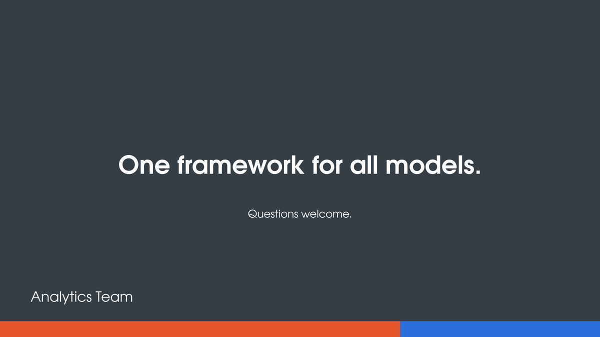
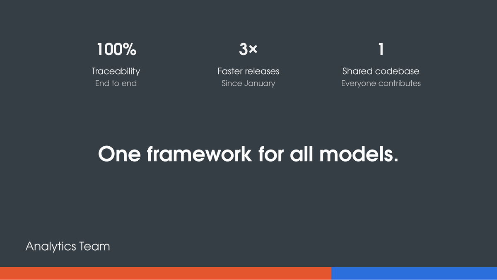

This page covers the `Closing` slide and its row of figures.

## A closing message

```python
from banners import Closing

Closing(title="One framework for all models.", subtitle="Questions welcome.")
```

{width=80%}

Keep the title short and conclusive: it is the sentence the audience leaves
with. The team comes from `configure(team=...)`.

## Key figures

`stats` adds a row of figures above the title. Each figure is a tuple of a
value, a label and a caption:

```python
from banners import Closing

Closing(
    title="One framework for all models.",
    stats=[
        ("100%", "Traceability", "End to end"),
        ("3×", "Faster releases", "Since January"),
        ("1", "Shared codebase", "Everyone contributes"),
    ],
)
```

{width=80%}

Two to four figures read best, with short values.

## A logo only

`Closing(title="")` shows the template's logo, centered, and the team. It
needs a template with a logo; see
[Your organization's template](../howto/organization-template.qmd).

## Options

| Argument | Default | Meaning |
|---|---|---|
| `title` | — | Final message; `""` shows the centered logo. |
| `subtitle` | `""` | Support sentence under the title. |
| `stats` | `None` | List of `(value, label, caption)` shown above the title. |
| `team` | `configure(team=...)` | Team line. |
| `palette` | the deck's palette | Colors for this slide only. |
| `background` | `configure(background=...)` | Background of the canvas. |
