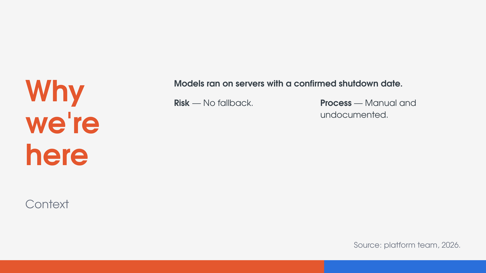

This page covers the `Intro` slide, usually the second or third slide of a
talk, where the problem or the context is set.

## Example

```python
from banners import Intro, Text

Intro(
    title="Why we're here",
    tag="Context",
    summary="Models ran on servers with a confirmed shutdown date.",
    content=[Text("**Risk** — No fallback."), Text("**Process** — Manual and undocumented.")],
    footer="Source: platform team, 2026.",
)
```

{width=80%}

The title takes the left column in large type. On the right, `summary` states
the one idea the audience must remember, in bold, and each element of
`content` becomes a column under it.

## Options

| Argument | Default | Meaning |
|---|---|---|
| `title` | — | Heading, shown large on the left. |
| `subtitle` | `""` | Support sentence under the title. |
| `tag` | `""` | Short label under the title when there is no subtitle, such as `"Context"`. |
| `summary` | `""` | Key sentence in bold above the content; markdown works. |
| `content` | `None` | Elements shown side by side on the right. |
| `footer` | `""` | Note at the bottom right, such as a source. |
| `team` | `configure(team=...)` | Team line. |
| `palette` | the deck's palette | Colors for this slide only. |
| `background` | `configure(background=...)` | Background of the canvas. |
