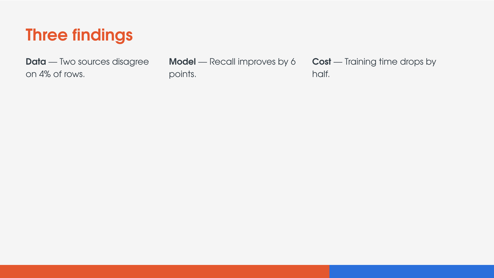
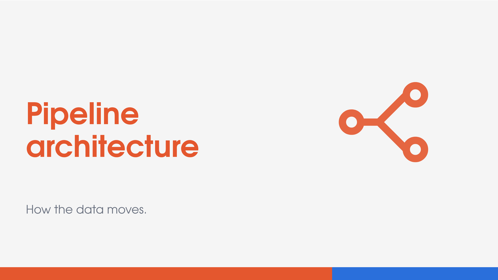
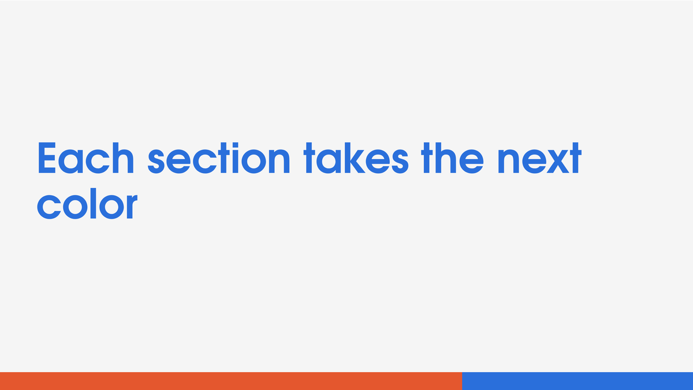

This page covers `Section`, the slide that carries most of a talk: how it
numbers itself, how it becomes a divider, and its options. Which layout a
section takes depends on its content; [Layouts](../look/layouts.qmd) has the
rules.

## Content slides

```python
from banners import Section, Text

Section(
    title="Three findings",
    content=[
        Text("**Data** — Two sources disagree on 4% of rows."),
        Text("**Model** — Recall improves by 6 points."),
        Text("**Cost** — Training time drops by half."),
    ],
)
```

{width=80%}

`content` takes one element or a list. Any element of the
[Content](../content/text.qmd) part of this guide works: text, images,
tables, plots, diagrams and animations.

## Dividers

Without content, a section becomes a divider that opens a part of the talk.
It shows a photo or a large icon when the template has one:

```python
from banners import Section, Template, configure

configure(template=Template(divider_icon="flow"))
Section(title="Pipeline architecture", subtitle="How the data moves.")
```

{width=80%}

The icon names are `chart`, `layers`, `target`, `compass`, `spark`, `leaf`,
`globe`, `shield`, `grid`, `orbit`, `pulse`, `building`, `flow` and
`mountain`. Any image source works as well.

## Numbering and section colors

Each section takes the next number (`01`, `02`, …) when it is created.
Because marimo runs cells in notebook order, the numbers follow the order of
the cells, and `configure()` restarts the count. The layouts do not print the
number: it picks the color of the section when the palette has
`section_colors`, so consecutive sections cycle through those colors.
`number=` sets the number by hand:

```python
from banners import Palette, Section

rainbow = Palette(section_colors=("#e4572e", "#2a6fdb", "#2e9e5b"))
Section(title="Each section takes the next color", number="02", palette=rainbow)
```

{width=80%}

## Options

| Argument | Default | Meaning |
|---|---|---|
| `title` | — | Heading of the slide. |
| `subtitle` | `""` | Support sentence under the title. |
| `content` | `None` | One element or a list; `None` makes a divider. |
| `number` | automatic | Section number; with `section_colors` it picks the color. |
| `image` | the template's `divider_image` | Photo: right half of a divider, left half of a content slide; `False` hides the template's photo. |
| `footer` | `""` | Note at the bottom right. |
| `palette` | the deck's palette | Colors for this slide only. |
| `background` | `configure(background=...)` | Background of the canvas. |
