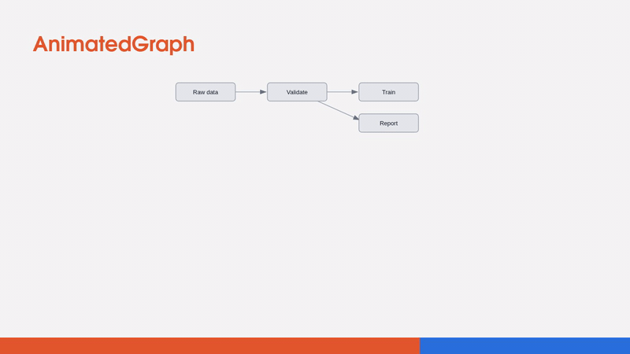

Esta página cubre `AnimatedGraph`, un diagrama de flujo interactivo para
explicar un proceso paso a paso.

## Ejemplo

```python
from banners import AnimatedGraph, Section

Section(
    title="AnimatedGraph",
    content=[AnimatedGraph("""
graph LR
A[Datos crudos] --> B[Validar]
B --> C[Entrenar]
B --> D[Reportar]
""")],
)
```

{width=80%}

## Qué acepta

`AnimatedGraph` lee una parte de la sintaxis de diagramas de flujo de Mermaid:

- Una primera línea `graph LR` (de izquierda a derecha) o `graph TD` (de
  arriba abajo).
- Una conexión por línea: `A --> B`, con etiquetas opcionales en los nodos
  (`A[Datos crudos]`, `B(Redondo)`, `C{Decisión}`) y en la conexión
  (`A -->|sí| B`).
- Un nodo solo en su línea, como `E[Archivo]`, para agregar un nodo sin
  conexiones.

banners lee el diagrama y ubica los nodos por su cuenta, así que el resultado
no depende de una librería del navegador.

## Opciones

| Argumento | Por defecto | Significado |
|---|---|---|
| `diagram` | — | El código de Mermaid `graph LR` / `graph TD`. |
| `highlight_color` | `"#ea580c"` | Color de relleno de un nodo resaltado. |

## Límites

- Necesita un notebook de marimo en ejecución (`marimo edit` o `marimo run`):
  el notebook atiende los clics, así que una exportación estática a HTML
  muestra un error en su lugar.
- Solo admite diagramas de flujo. Para otros diagramas de Mermaid, o para
  conexiones encadenadas como `A --> B --> C` en una línea, usa
  [`Graph`](graph.qmd).
