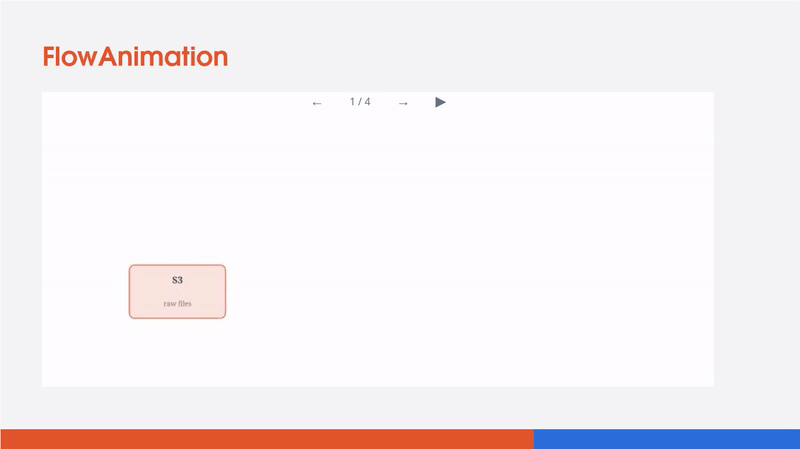

Esta página cubre `FlowAnimation`: sus tres formatos de entrada, sus opciones
y lo que necesita para correr.

## Ejemplo

```python
from banners import FlowAnimation, Section

Section(
    title="FlowAnimation",
    content=[FlowAnimation([
        {"name": "S3", "detail": "archivos crudos"},
        {"name": "Glue", "detail": "proceso ETL"},
        {"name": "Athena", "detail": "SQL"},
        {"name": "Dashboard", "detail": "BI"},
    ])],
)
```

{width=80%}

El reproductor sobre la animación tiene botones para retroceder y avanzar, un
contador de pasos y un botón de reproducción automática; un clic en la
animación también la hace avanzar. Cada paso dura un cuarto de segundo, y los
nodos y las flechas toman los colores de la paleta de la slide.

## Tres formas de describir el flujo

**Una lista** da una cadena, de izquierda a derecha:

```python
from banners import FlowAnimation

FlowAnimation(["S3", "Glue", "Athena"])
```

Cada nodo es un nombre, o un diccionario con `name` y un `detail` que aparece
debajo.

**Una lista de listas** da capas, de arriba abajo; cada nodo de una capa se
conecta con cada nodo de la siguiente:

```python
from banners import FlowAnimation

FlowAnimation([
    ["Ingesta"],
    [{"name": "Transformación A", "detail": "variables"}, {"name": "Transformación B", "detail": "filtros"}],
    ["Carga"],
])
```

**Nodos y conexiones** dan cualquier grafo; la disposición se calcula a partir
de las conexiones:

```python
from banners import FlowAnimation

FlowAnimation(
    nodes=["Ingesta A", "Ingesta B", "Validar", "Entrenar"],
    edges=[("Ingesta A", "Validar"), ("Ingesta B", "Validar"), ("Validar", "Entrenar")],
)
```

## Opciones

| Argumento | Por defecto | Significado |
|---|---|---|
| `nodes` | — | Los nodos, en uno de los tres formatos anteriores. |
| `edges` | `None` | Pares `(origen, destino)`; activa el formato de grafo. |
| `direction` | `"LR"` en listas y grafos, `"TD"` en capas | `"LR"` (de izquierda a derecha) o `"TD"` (de arriba abajo). |
| `quality` | `"low"` | Calidad del render: `"low"`, `"medium"` o `"high"`. |
| `width` | `"100%"` | Ancho máximo del reproductor, cualquier valor de CSS. |
| `autoplay` | `False` | Avanzar solo al terminar cada paso. |
| `palette` | la paleta de la slide | Colores de la animación. |

## Requisitos

`FlowAnimation` se dibuja con [Manim](manim.qmd), así que necesita el extra
`manim` y sus librerías del sistema. El primer render de un flujo toma unos
segundos; los siguientes salen de una caché en disco (ver
[Caché y velocidad](../howto/cache.qmd)).
