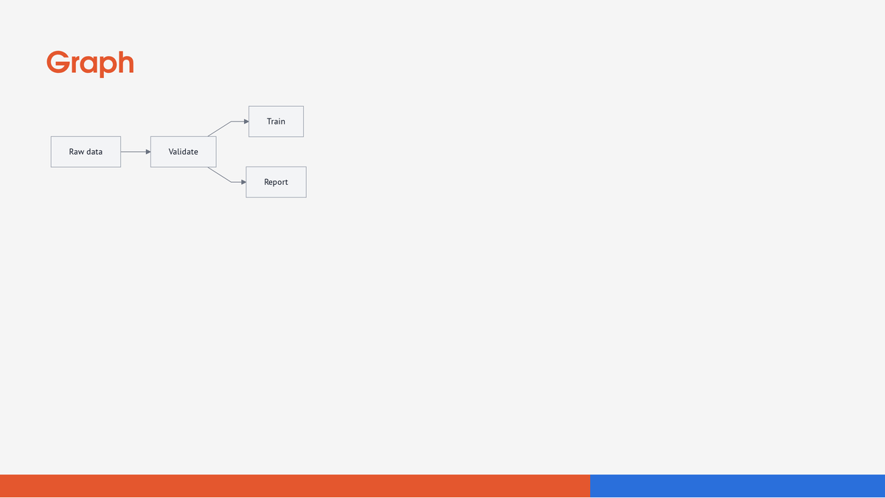

Esta página cubre `Graph`, el elemento para diagramas escritos como texto.

## Ejemplo

```python
from banners import Graph, Section

Section(
    title="Diagrama",
    content=[Graph("graph LR\n  A[Datos crudos] --> B[Validar]\n  B --> C[Entrenar]\n  B --> D[Reportar]")],
)
```

{width=80%}

`Graph(diagram)` recibe código de [Mermaid](https://mermaid.js.org) y lo dibuja
con el soporte de Mermaid de marimo. Sirve cualquier tipo de diagrama de
Mermaid: de flujo (`graph LR`, `graph TD`), de secuencia, de estados y otros.

## Diagramas de varias líneas

Un texto entre comillas triples mantiene el diagrama legible:

```python
from banners import Graph

Graph("""
graph TD
    A[Ingesta] --> B{¿Válido?}
    B -- sí --> C[Cargar]
    B -- no --> D[Cuarentena]
""")
```

banners agrega un tema neutro de Mermaid, salvo que el diagrama fije el suyo
con una línea `%%{init: …}%%`.

## Graph o AnimatedGraph

`Graph` es estático y admite todas las funciones de Mermaid. Para un diagrama
de flujo que la audiencia recorre haciendo clic en sus nodos, usa
[`AnimatedGraph`](animated-graph.qmd).
