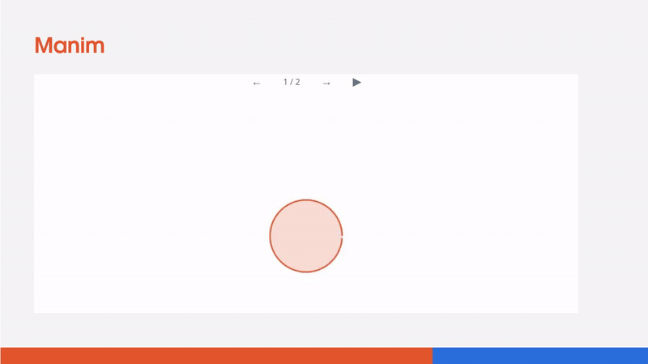

Esta página cubre `Manim`: cómo instalarlo, las tres formas de mostrar una
escena y cómo la escena sigue los colores de la slide.

## Instalación

```bash
pip install "marimo-banners[manim]"
```

Manim dibuja con cairo y pango y codifica video con ffmpeg, así que el sistema
necesita esas librerías:

::: {.panel-tabset}
## Ubuntu / Debian

```bash
sudo apt install python3-dev libpango1.0-dev pkg-config libcairo2-dev libx11-dev libgl1-mesa-dev ffmpeg
```

## Fedora

```bash
sudo dnf install gcc-c++ python3-devel pkgconf-pkg-config cairo-devel pango-devel libX11-devel mesa-libGL-devel ffmpeg
```
:::

Las escenas que escriben fórmulas con `MathTex` también necesitan una
instalación de LaTeX con el paquete `standalone` y `dvisvgm` (en Fedora,
`texlive-standalone` y `texlive-dvisvgm`).

## Una escena paso a paso

Con `interactive=True`, cada `self.next_section()` de la escena se vuelve un
paso, y cada clic en el reproductor muestra el siguiente:

```python
from banners import ORANGE, Manim, Section
from manim import Circle, Create, Scene, Square, Transform

class ShapeScene(Scene):
    def construct(self):
        self.next_section("circulo")
        forma = Circle(color=ORANGE.primary, fill_opacity=0.2)
        self.play(Create(forma), run_time=0.4)
        self.next_section("cuadrado")
        self.play(Transform(forma, Square(color=ORANGE.secondary, fill_opacity=0.2)), run_time=0.4)

Section(title="Manim", content=[Manim(ShapeScene, interactive=True)])
```

{width=80%}

Pasa la clase de la escena, no una instancia. [Una escena Manim paso a
paso](../howto/manim-scene.qmd) explica cómo escribir escenas que se presenten
bien.

## Imágenes y videos

Sin `interactive`, la escena completa se reproduce de una vez:

| `format` | Se muestra como |
|---|---|
| `"gif"` (por defecto) | Una imagen animada que se repite. |
| `"png"` | El último cuadro, como imagen fija. |
| `"mp4"` | Un video con controles; `autoplay=True` lo reproduce sin sonido y en bucle. |

## Colores

La escena se dibuja sobre el color `palette.panel` de la slide, así que se
integra con ella, y los botones del reproductor usan `muted` y `primary`. Una
escena que fija `self.camera.background_color` conserva su propio fondo. Las
formas y los textos mantienen los colores que la escena les da; importar una
paleta (como `ORANGE` arriba) permite que una escena use los colores de la
presentación.

## Opciones

| Argumento | Por defecto | Significado |
|---|---|---|
| `scene` | — | Una subclase de `Scene` de Manim, o una función que devuelve una. |
| `format` | `"gif"` | `"gif"`, `"png"` o `"mp4"` cuando no es interactiva. |
| `quality` | `"low"` | `"low"`, `"medium"` o `"high"`; más alta es más nítida y más lenta. |
| `interactive` | `False` | Un paso por `next_section()`, que avanza con clics. |
| `width` | `"100%"` | Ancho máximo del reproductor. |
| `autoplay` | `False` | Interactiva: avanza sola; mp4 estático: se reproduce sin sonido y en bucle. |
| `palette` | la paleta de la slide | Colores del fondo y del reproductor. |

## Una escena lista para usar

`banners.scenes.PipelineScene` es una animación de un pipeline de datos en
siete pasos que sigue la paleta:

```python
from banners import Manim, Section
from banners.scenes import PipelineScene

Section(title="Nuestro pipeline", content=[Manim(PipelineScene, interactive=True)])
```

Los renders se guardan en una caché en disco, así que una escena se dibuja una
sola vez; ver [Caché y velocidad](../howto/cache.qmd).
