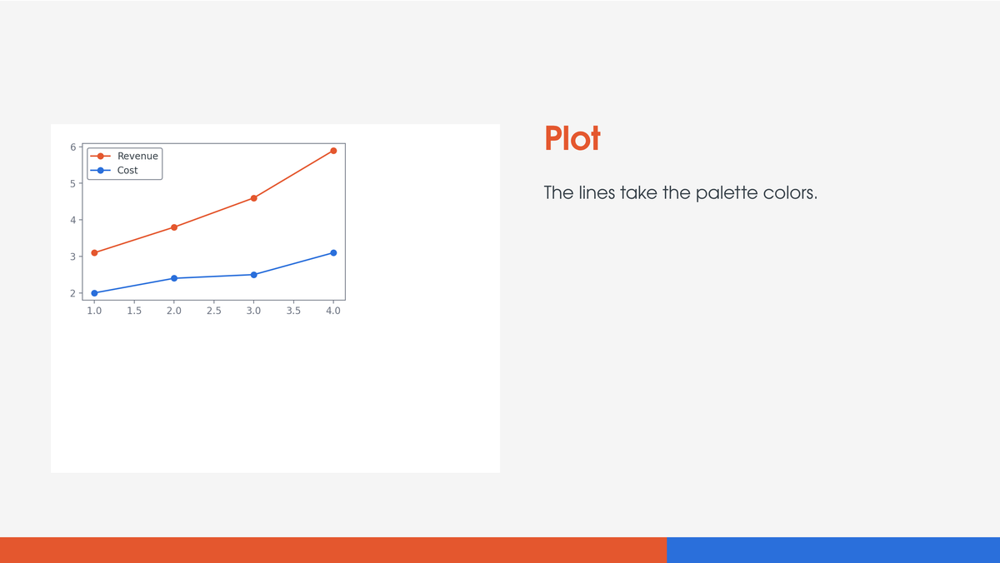

Esta página cubre `Plot`, cómo un gráfico toma los colores de la slide y
cuándo no lo hace.

## Ejemplo

```python
import matplotlib.pyplot as plt
from banners import Plot, Section, Text

fig, ax = plt.subplots(figsize=(5, 3))
ax.plot([1, 2, 3, 4], [3.1, 3.8, 4.6, 5.9], marker="o", label="Ingresos")
ax.plot([1, 2, 3, 4], [2.0, 2.4, 2.5, 3.1], marker="o", label="Costos")
ax.legend()
Section(title="Gráfico", content=[Plot(fig), Text("Las líneas toman los colores de la paleta.")])
```

El mismo gráfico en dos slides con paletas distintas:

::: {layout-ncol=2}



:::

## Cómo un gráfico sigue la paleta

Cuando un gráfico de matplotlib se pone en una slide, banners le da estilo a
una copia (tu figura no se modifica):

- Los fondos de la figura y de los ejes se vuelven transparentes, así que se
  ve la slide detrás.
- Las líneas, barras y marcadores dibujados con los colores automáticos de
  matplotlib toman las series de la paleta: `section_colors`, o `primary` y
  `secondary`.
- Los títulos, las etiquetas de los ejes y el texto de la leyenda toman
  `palette.text`; las marcas, los bordes y la grilla toman `palette.muted`; el
  recuadro de la leyenda toma `palette.panel`.

Los colores que fijes a mano (`color="#3b82f6"`) se conservan. Para mantener
un gráfico exactamente como lo dibujaste, fija sus colores de forma explícita.

## plotly

`Plot` también acepta un gráfico de plotly y detecta la librería por sí mismo.
Los gráficos de plotly se muestran tal cual, sin el estilo de la paleta:

```python
# fragment: necesita plotly instalado.
import plotly.express as px
from banners import Plot, Section

fig = px.line(x=[1, 2, 3, 4], y=[3.1, 3.8, 4.6, 5.9])
Section(title="Plotly", content=[Plot(fig)])
```

Un gráfico que no es de matplotlib ni de plotly produce un `TypeError` al
dibujar la slide.
