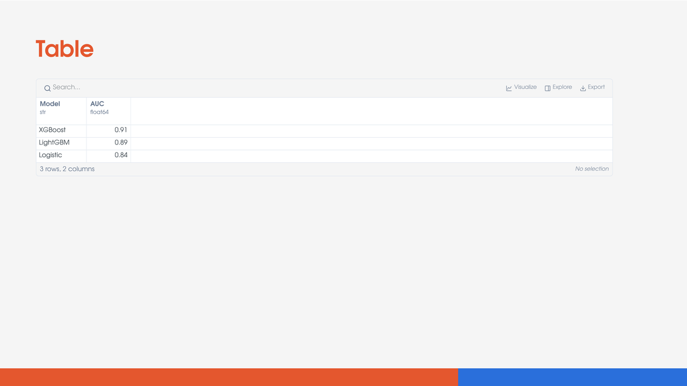

Esta página cubre `Table`, el elemento para datos en tabla.

## Ejemplo

```python
import pandas as pd
from banners import Section, Table

df = pd.DataFrame({"Modelo": ["XGBoost", "LightGBM", "Logística"], "AUC": [0.91, 0.89, 0.84]})
Section(title="Tabla", content=[Table(df)])
```

{width=80%}

`Table(df)` muestra el DataFrame con el componente de tabla de marimo, que
agrega un buscador, los tipos de cada columna y botones para exportar.

## Límites

- La tabla de marimo tiene sus propios tamaños de fuente, así que no crece con
  la slide como el texto. Mantén las tablas cortas (pocas filas y columnas)
  para que se lean bien en pantalla completa.
- Para pocas cifras, una tabla en markdown dentro de un [`Text`](text.qmd)
  sigue la fuente y los colores de la slide:

```python
from banners import Section, Text

Section(
    title="Comparación de modelos",
    content=[Text("| Modelo | AUC |\n|---|---|\n| XGBoost | 0.91 |\n| Logística | 0.84 |")],
)
```

pandas no es una dependencia de banners; instálalo para usar `Table`.
