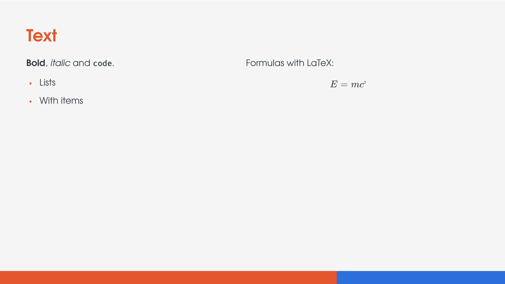

Esta página cubre `Text`, el elemento para palabras, listas y fórmulas.

## Ejemplo

```python
from banners import Section, Text

Section(
    title="Texto",
    content=[
        Text("**Negrita**, *cursiva* y `código`.\n\n- Listas\n- Con elementos"),
        Text("Fórmulas con LaTeX:\n\n$$E = mc^2$$"),
    ],
)
```

{width=80%}

## Qué acepta

`Text(body)` recibe un texto en markdown: párrafos, **negrita**, *cursiva*,
`código`, listas, enlaces, tablas y bloques de código. Las fórmulas usan LaTeX
entre `$…$` (en la línea) o `$$…$$` (en su propia línea). En textos de Python
con barras invertidas, como los comandos de LaTeX, un raw string evita
duplicarlas:

```python
from banners import Text

Text(r"La ecuación de onda: $\nabla^2 \mathbf{E} = \frac{1}{c^2}\frac{\partial^2 \mathbf{E}}{\partial t^2}$")
```

## Cómo se ve en una slide

El template fija la fuente, el tamaño y el color del texto, así que un `Text`
se ve igual en todas las slides de la presentación. Cada `Text` de `content`
se vuelve una columna; una lista de tres `Text` da tres columnas lado a lado.
El código en línea toma el color del texto de la slide, por lo que sigue
legible sobre fondos oscuros; los bloques de código conservan su propio
recuadro claro.

Un patrón común es un comienzo en negrita seguido de un guion y el detalle,
un `Text` por idea:

```python
from banners import Section, Text

Section(
    title="Resultados",
    content=[
        Text("**Precisión** — 91% de AUC en el conjunto de prueba."),
        Text("**Latencia** — p99 bajo 30 ms."),
    ],
)
```
