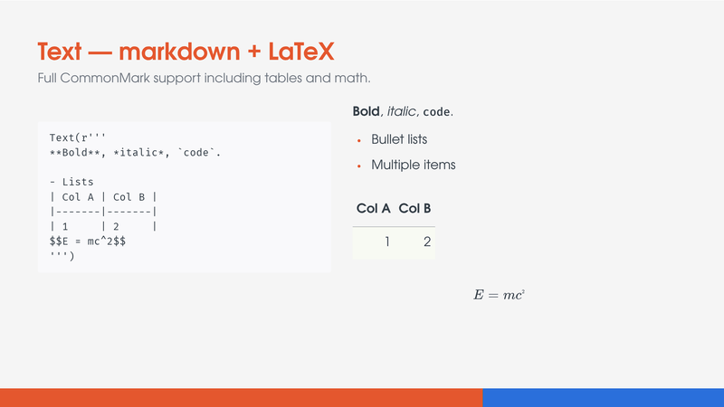
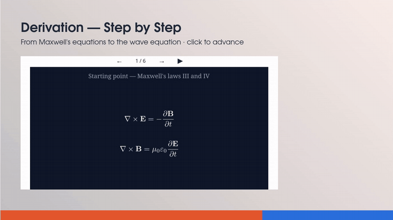

El repositorio trae dos presentaciones de ejemplo en la carpeta `example/`.
Clónalo para ejecutarlas:

```bash
git clone https://github.com/kascesar/banners
cd banners
uv sync --extra dev
```

## Showcase

`example/showcase.py` recorre cada función, una slide a la vez, con el código
de cada slide al lado.

::: {layout-ncol=1}





:::

```bash
uv run marimo edit example/showcase.py
```

## Ondas electromagnéticas

`example/ondas_electromagneticas.py` es una charla completa: las ecuaciones de
Maxwell, una derivación animada paso a paso de la ecuación de onda y un
gráfico de la onda resultante. Necesita el extra `manim` y LaTeX.



```bash
uv run marimo edit example/ondas_electromagneticas.py
```
