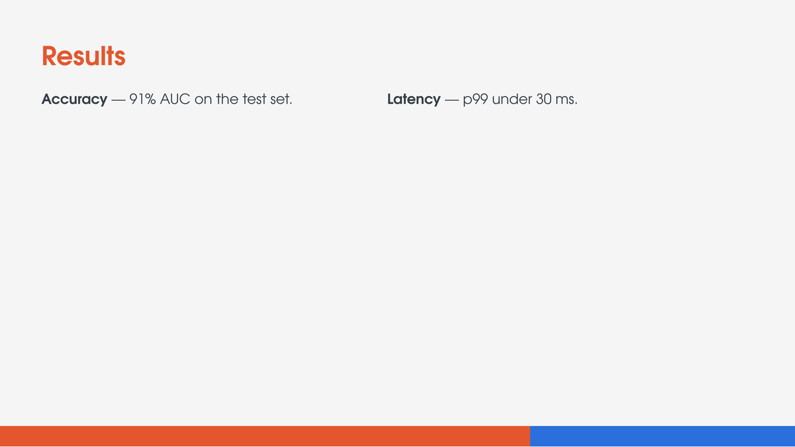
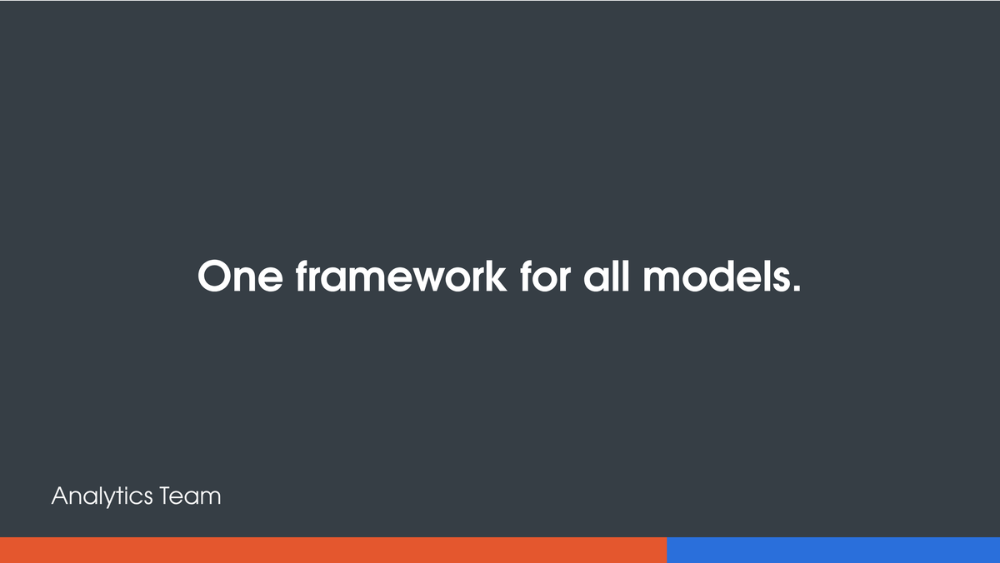

Esta página va desde instalar banners hasta presentar en pantalla completa una
presentación de tres slides. Cubre la instalación, el primer notebook, los tres
tipos de slide más comunes y la vista de slides de marimo.

## Instalación

banners necesita Python 3.11 o superior e instala marimo junto con él.

::: {.panel-tabset}
## pip

```bash
pip install marimo-banners
```

## uv

```bash
uv add marimo-banners
```
:::

Los elementos animados (`FlowAnimation`, `Manim`) necesitan un extra y algunas
librerías del sistema; la [página de Manim](content/manim.qmd) las enumera.
Nada de esta página las necesita.

## Crear un notebook

Los notebooks de marimo son archivos de Python. Crea uno y ábrelo en el editor:

```bash
marimo edit deck.py
```

## Escribir tres slides

Escribe cada bloque en su propia celda. Una celda muestra el valor de su última
expresión, así que cada celda muestra una slide.

```python
# Celda 1: valores que comparten todas las slides.
from banners import Closing, Cover, Section, Text, configure

configure(team="Equipo de Analítica", date="2026")

# Celda 2: la portada abre la charla.
Cover(title="Predicción de fuga v2", subtitle="Migración y despliegue del modelo.")

# Celda 3: una sección contiene el contenido.
Section(
    title="Resultados",
    content=[
        Text("**Precisión** — 91% de AUC en el conjunto de prueba."),
        Text("**Latencia** — p99 bajo 30 ms."),
    ],
)

# Celda 4: la slide de cierre lleva el mensaje final.
Closing(title="Un solo marco para todos los modelos.")
```

::: {layout-ncol=3}





:::

Las tres slides que muestran las celdas de arriba.

`configure()` guarda los valores que comparten todas las slides, como el nombre
del equipo y la fecha, para que las slides no los repitan. Las páginas de
[Slides](slides/cover.qmd) describen cada tipo de slide y sus opciones.

::: {.callout-note}
## El orden de las celdas importa

Una `Section` toma su número (`01`, `02`, …) cuando se ejecuta su celda, así
que las secciones se numeran en el orden de las celdas del notebook, y llamar
a `configure()` reinicia la cuenta. El número elige el color de cada sección
en las paletas que tienen un color por sección.
:::

## Verla como slides

marimo puede mostrar un notebook como slides, una celda por slide y con el
código oculto:

1. En el editor, abre la vista de app (el botón de vista previa abajo a la
   derecha, o <kbd>Ctrl</kbd>/<kbd>Cmd</kbd> + <kbd>.</kbd>).
2. En el menú de layout de la vista de app, elige **Slides**. marimo guarda
   esta elección en una carpeta `layouts/` junto al notebook.
3. Para presentar, ejecuta el notebook como app y pon el navegador en pantalla
   completa (<kbd>F11</kbd> en la mayoría de los sistemas):

```bash
marimo run deck.py
```

[Presentar en pantalla completa](howto/present.qmd) cubre los detalles, como
ocultar las celdas que no son slides.

## Cambiar la apariencia

La presentación de arriba usa el template por defecto. Un argumento lo cambia:

```python
from banners import COSMOS, configure

configure(template=COSMOS)
```

Cada slide creada después de esta llamada toma el estilo oscuro de COSMOS. La
página de [Templates](look/templates.qmd) los muestra todos, y las páginas
siguientes de la guía explican cómo cambiar colores, fuentes y fondos.
