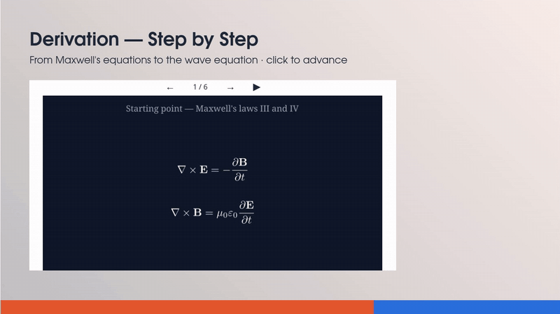

banners es una librería de Python para armar presentaciones en notebooks de
[marimo](https://marimo.io). Cada slide es un objeto de Python dibujado sobre un
lienzo fijo de 16:9, de modo que el texto, los gráficos, las tablas, los
diagramas y las animaciones de una charla quedan junto al código que los
produjo, y la presentación conserva sus proporciones desde una celda del
notebook hasta un proyector.

## Una slide, seis estilos

La misma slide dibujada con cada template incluido. Cambiar el template es una
línea de código; las slides no cambian.

::: {layout-ncol=2}


:::

## Animaciones que avanzan con cada clic

Una escena de [Manim](https://www.manim.community) puede correr paso a paso
dentro de una slide: cada clic muestra el paso siguiente, dibujado con los
colores de la slide.



## Instalación

```bash
pip install marimo-banners
```

banners necesita Python 3.11 o superior. Las animaciones necesitan el extra
`manim`; la [página de Manim](content/manim.qmd) lo explica.

## Una presentación en pocas líneas

```python
from banners import TERRA, Closing, Cover, Section, Text, configure

configure(template=TERRA, team="Equipo de Analítica", date="2026")

Cover(title="Predicción de fuga v2", subtitle="Migración y despliegue del modelo.")
Section(title="Resultados", content=[Text("**Precisión** — 91% de AUC.")])
Closing(title="Un solo marco para todos los modelos.")
```

En un notebook de marimo cada slide va al final de su propia celda, donde
marimo la muestra. [Primeros pasos](get-started.qmd) lo recorre completo, desde
la instalación hasta presentar en pantalla completa.

## Por dónde seguir

- [Primeros pasos](get-started.qmd): una primera presentación en cinco minutos.
- [Apariencia](look/templates.qmd): templates, paletas, temas, layouts y fondos.
- [Slides](slides/cover.qmd): los cuatro tipos de slide y sus opciones.
- [Contenido](content/text.qmd): texto, imágenes, tablas, gráficos, diagramas y animaciones.
- [Guías prácticas](howto/present.qmd): presentar, el template de tu organización, escenas de Manim.
