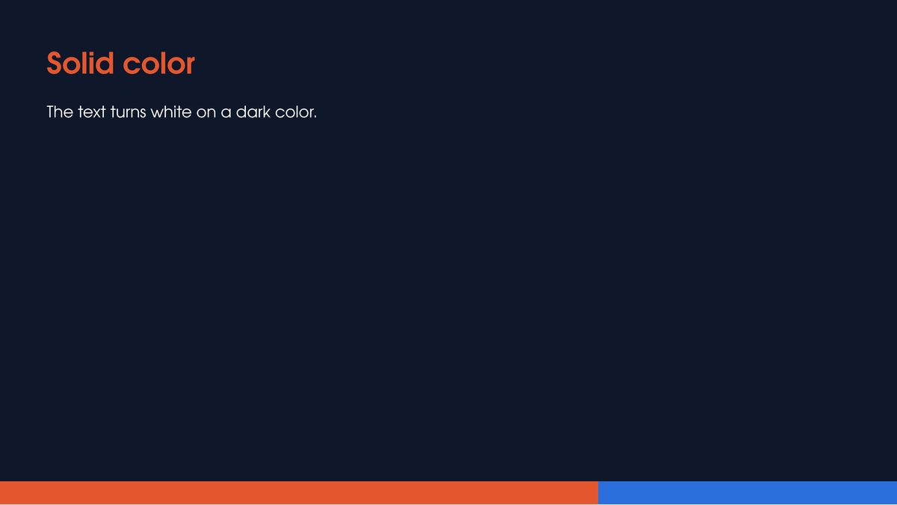
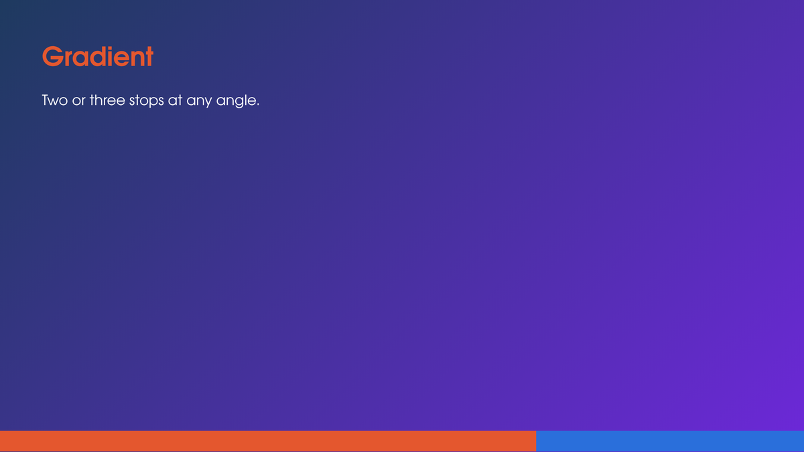
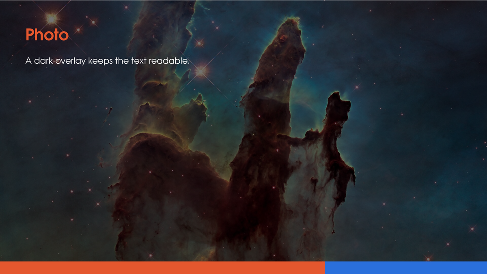

Esta página cubre los tres tipos de fondo, cómo se adapta el color del texto
a ellos y cómo fijar un fondo para una slide o para toda la presentación.

## Tres tipos

`Background` tiene un constructor por tipo:

| Constructor | Pinta |
|---|---|
| `Background.color(c)` | Un color de CSS. |
| `Background.gradient(start, end, mid=None, angle=135)` | Un degradado lineal de dos o tres colores, en un ángulo en grados. |
| `Background.image(src, overlay="rgba(0,0,0,0.55)")` | Una foto desde una URL, una ruta de archivo o bytes, bajo una capa oscura. |

```python
from banners import Background, Section, Text

Section(
    title="Color sólido",
    content=[Text("El texto se vuelve blanco sobre un color oscuro.")],
    background=Background.color("#0f172a"),
)
```

```python
from banners import Background, Section, Text

Section(
    title="Degradado",
    content=[Text("Dos o tres colores en cualquier ángulo.")],
    background=Background.gradient("#1e3a5f", "#6d28d9", angle=135),
)
```

```python
# fragment: descarga la foto al crear el fondo.
from banners import Background, Section, Text

Section(
    title="Foto",
    content=[Text("Una capa oscura mantiene el texto legible.")],
    background=Background.image(
        "https://commons.wikimedia.org/wiki/Special:FilePath/"
        "Pillars_of_creation_2014_HST_WFC3-UVIS_full-res_denoised.jpg?width=1600"
    ),
)
```

::: {layout-ncol=3}





:::

## El texto se adapta

banners lee el primer color del fondo y mide qué tan claro es. Sobre un fondo
oscuro, el texto y los subtítulos se vuelven blancos; sobre uno claro, siguen
oscuros. Por eso un degradado oscuro no requiere cambiar la paleta. El título
conserva el color `primary` de la paleta, salvo que se leyera mal.

En una foto decide la capa: la capa oscura por defecto vuelve blanco el texto.
`overlay=None` la quita; entonces banners no puede medir la foto, el texto
conserva los colores de la paleta, y una foto oscura puede necesitar una
paleta con texto claro.

## Una slide o toda la presentación

`background=` en una slide pinta esa slide. `configure(background=...)` pinta
todas las slides que no fijan el suyo:

```python
from banners import Background, configure

configure(background=Background.gradient("#0f172a", "#1e3a5f"))
```

Una foto dada por URL se descarga una vez, al crear el fondo, y queda
incrustada en las slides. La descarga verifica el certificado del servidor; si
falla, se produce un error en vez de una slide en blanco.
