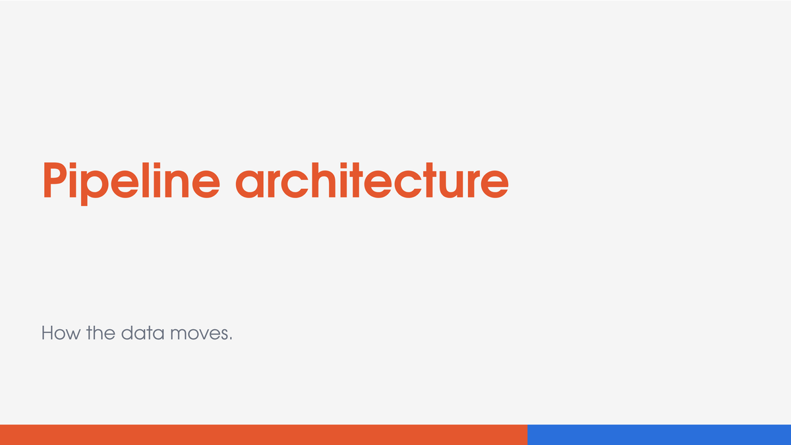
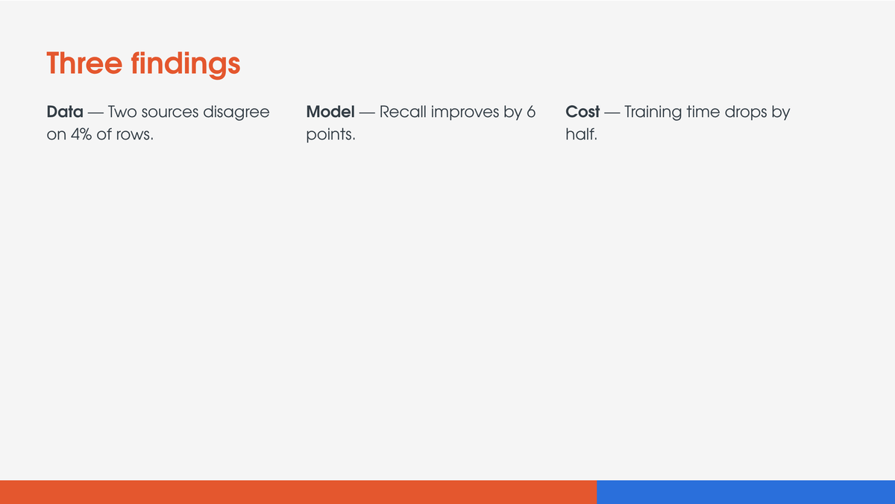
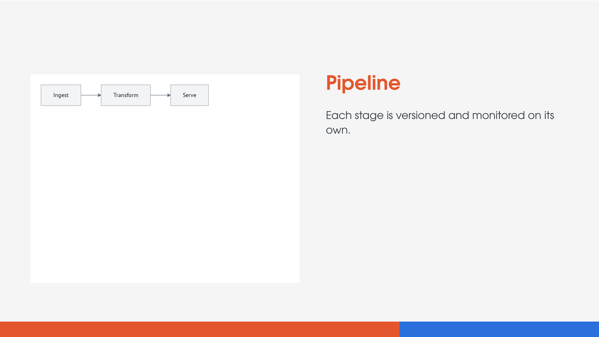
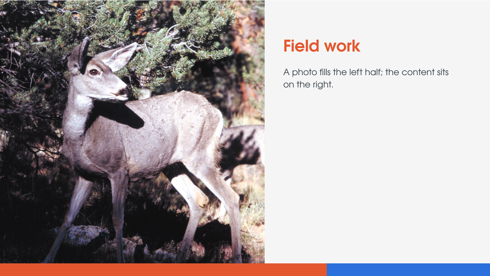

Esta página cubre cómo banners elige el layout de cada slide. No hay un
argumento de layout: el template decide según el tipo de slide y lo que
pongas en ella, de modo que el mismo código produce slides coherentes en toda
la presentación.

## Las reglas

| Slide | Layout |
|---|---|
| `Cover()` | Portada oscura con el logo, el título en el color primario, subtítulo y fecha. |
| `Cover(image=...)` | Portada con foto y el título sobre la imagen. |
| `Intro()` | Título grande en la columna izquierda, contenido en columnas a la derecha. |
| `Section()` sin contenido | Separador: título, subtítulo y una foto o un ícono grande. |
| `Section(content=[visual, Text(...)])` | El visual a la izquierda, título y texto a la derecha. |
| `Section(content=..., image=...)` | Foto en la mitad izquierda, título y contenido a la derecha. |
| `Section(content=...)` en otro caso | Título arriba, contenido en columnas debajo. |
| `Closing()` | Fondo de cierre con el título, una fila opcional de cifras y el equipo. |

Un *visual* es un gráfico, un diagrama, una tabla, una imagen o una animación;
el texto es `Text`.

## Un separador

Una `Section` sin contenido separa las partes de una charla:

```python
from banners import Section

Section(title="Arquitectura del pipeline", subtitle="Cómo se mueven los datos.")
```

{width=70%}

## Contenido en columnas

Varios elementos `Text` quedan lado a lado, una columna cada uno:

```python
from banners import Section, Text

Section(
    title="Tres hallazgos",
    content=[
        Text("**Datos** — Dos fuentes difieren en el 4% de las filas."),
        Text("**Modelo** — El recall mejora en 6 puntos."),
        Text("**Costo** — El tiempo de entrenamiento baja a la mitad."),
    ],
)
```

{width=70%}

## Un visual junto a su explicación

Un visual seguido de texto deja el visual a la izquierda y la explicación a la
derecha:

```python
from banners import Graph, Section, Text

Section(
    title="Pipeline",
    content=[
        Graph("graph LR\n  A[Ingesta] --> B[Transformación] --> C[Servicio]"),
        Text("Cada etapa se versiona y se monitorea por separado."),
    ],
)
```

{width=70%}

## Una foto junto al contenido

`image=` pone una foto en la mitad izquierda:

```python
from banners import Section, Text

Section(
    title="Trabajo de campo",
    content=[Text("Una foto ocupa la mitad izquierda; el contenido queda a la derecha.")],
    image="https://commons.wikimedia.org/wiki/Special:FilePath/Grand_Canyon_National_Park_GRCA9857.jpg?width=1600",
)
```

{width=70%}

## El lienzo de 16:9

Cada layout ubica sus partes sobre un lienzo fijo de 16:9, con posiciones y
tamaños de fuente relativos al ancho de la slide. Por eso una slide se ve
igual en una celda del notebook, en una ventana del navegador y en pantalla
completa: solo cambia su tamaño.
