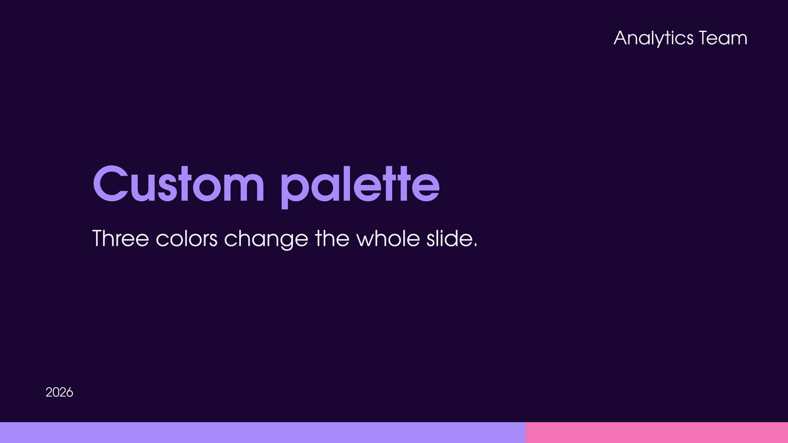

Esta página cubre los roles de color de una paleta, las cinco paletas
incluidas, cómo crear una propia y qué paleta gana cuando hay varias.

## Colores por rol

Una `Palette` no enumera "los colores de la marca": dice para qué sirve cada
color. El template pinta cada parte de una slide con el color de su rol:

| Rol | Por defecto | Pinta |
|---|---|---|
| `primary` | <span style="color:#e4572e">■</span> `#e4572e` | Los títulos y el tramo principal de la barra inferior. |
| `secondary` | <span style="color:#2a6fdb">■</span> `#2a6fdb` | El tramo final de la barra inferior. |
| `dark` | <span style="color:#404040">■</span> `#404040` | Fondo de la portada y del cierre que muestra solo el logo. |
| `closing_bg` | <span style="color:#363e45">■</span> `#363e45` | Fondo de la slide de cierre. |
| `light` | <span style="color:#f5f5f5">■</span> `#f5f5f5` | Fondo de los separadores y de las slides de contenido. |
| `text` | <span style="color:#343e46">■</span> `#343e46` | Texto sobre fondos claros. |
| `muted` | <span style="color:#6b7280">■</span> `#6b7280` | Subtítulos, etiquetas y notas sobre fondos claros. |
| `on_dark` | <span style="color:#f5f5f5;background:#404040">■</span> `#f5f5f5` | Texto sobre fondos oscuros. |
| `panel` | `#ffffff` | Fondo del recuadro que contiene un gráfico o una animación. |

Tres roles opcionales agregan variedad:

- `section_colors`: colores que las slides `Section` toman por turno según su
  número (la sección 01 el primero, la 02 el segundo, y así).
- `bar_colors`: colores de la barra inferior en tramos iguales, en vez de
  `primary` y `secondary`.
- `icon_color`: color de los íconos por nombre; por defecto toman el color del
  título.

Los gráficos y las animaciones de una slide también siguen la paleta: sus
series usan `section_colors` (o `primary` y `secondary`), sus etiquetas usan
`text` y `muted`, y su fondo es `panel`. Ver [Plot](../content/plot.qmd) y
[Manim](../content/manim.qmd).

## Las paletas incluidas

banners trae cinco paletas. `ORANGE` es la de por defecto.

::: {layout-ncol=3}


:::

## Una paleta propia

Crea una `Palette` con los roles que quieras cambiar; los demás conservan su
valor por defecto:

```python
from banners import Cover, Palette

marca = Palette(primary="#a78bfa", secondary="#f472b6", dark="#1a0533")
Cover(title="Paleta propia", subtitle="Tres colores cambian toda la slide.", palette=marca)
```

{width=70%}

`section_colors` le da a cada sección su propio color:

```python
from banners import Palette, Section

arcoiris = Palette(section_colors=("#e4572e", "#2a6fdb", "#2e9e5b"))
Section(title="Cada sección toma el color siguiente", number="02", palette=arcoiris)
```

{width=70%}

## Dónde se fija una paleta y cuál gana

Una paleta se puede fijar en tres lugares. Cuando hay más de una, gana la más
específica:

1. **En una slide**, con `palette=`: solo esa slide.
2. **Para la presentación**, con `configure(palette=...)`: todas las slides
   creadas después de la llamada.
3. **En el template**, con `Template(palette=...)`: la de por defecto.

```python
from banners import BLUE, GREEN, Section, configure

configure(palette=BLUE)                        # todas las slides en azul...
Section(title="Destacados", palette=GREEN)     # ...salvo esta
```

Una paleta siempre reemplaza completa a la de abajo: los roles no se mezclan.
`Palette(primary="#0f766e")` conserva los valores por defecto en todos los
demás roles, no los valores de la paleta del template.

::: {.callout-tip}
## Títulos legibles sobre cualquier fondo

Cuando el color de un título se leería mal sobre su fondo (un contraste menor
a 3:1), el template usa un color legible en su lugar. Para conservar los
colores exactos de una marca, crea el template con `auto_contrast=False`.
:::
