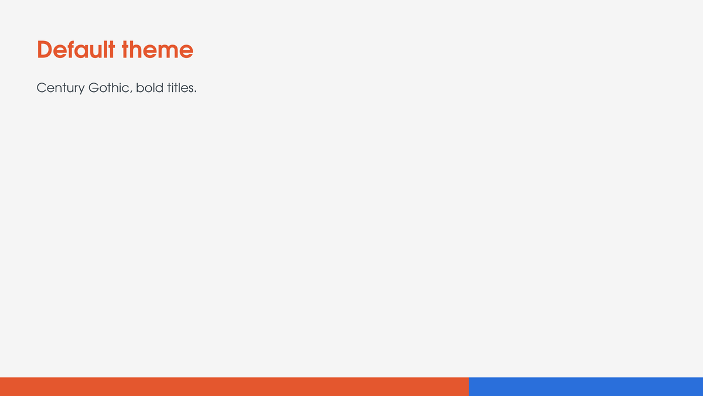
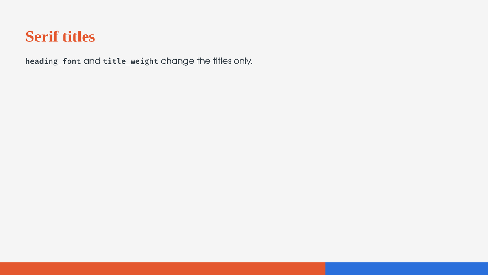

Esta página cubre los cinco ajustes de un `Theme` y dónde se fijan. Los
colores no son parte de un tema; pertenecen a la [paleta](palettes.qmd).

## Los ajustes

| Ajuste | Por defecto | Qué cambia |
|---|---|---|
| `font` | Century Gothic y fuentes geométricas similares | Todo el texto de la slide. |
| `heading_font` | `None` (igual a `font`) | Solo los títulos. |
| `title_weight` | `700` | El grosor de los títulos (400 normal, 600 seminegrita, 700 negrita). |
| `icon_stroke` | `1.6` | El grosor de línea de los íconos incluidos. |
| `scale` | `1.0` | Multiplicador de todos los tamaños de fuente. |

Las fuentes son listas de CSS: el navegador usa la primera fuente de la lista
que esté instalada. Una lista que termina en una familia genérica (`serif`,
`sans-serif`) siempre encuentra una fuente.

## Ejemplos

Una fuente con serifa para los títulos, menos gruesa que la negrita por
defecto:

```python
from banners import Section, Template, Text, Theme, configure

configure(template=Template(theme=Theme(heading_font="Georgia, serif", title_weight=600)))
Section(title="Títulos con serifa", content=[Text("`heading_font` y `title_weight` cambian solo los títulos.")])
```

Texto más grande, para una sala grande o una pantalla pequeña:

```python
from banners import Section, Template, Text, Theme, configure

configure(template=Template(theme=Theme(scale=1.25)))
Section(title="Texto más grande", content=[Text("`scale=1.25` agranda todas las fuentes en un 25%.")])
```

::: {layout-ncol=3}





:::

## Dónde se fija un tema

Un tema vive en un template (`Template(theme=...)`), y `configure(theme=...)`
lo reemplaza para toda la presentación:

```python
from banners import TERRA, Theme, configure

configure(template=TERRA, theme=Theme(font="'Inter', sans-serif"))
```

Igual que con las paletas, un tema reemplaza completo al tema del template:
los ajustes que no pases toman su valor por defecto. A diferencia de las
paletas, no hay un tema por slide; una presentación mantiene una sola
tipografía.

::: {.callout-note}
## Los tamaños siguen a la slide

Los tamaños de fuente son relativos al ancho de la slide, así que una slide
conserva sus proporciones en una celda del notebook, en una ventana del
navegador y en pantalla completa. `scale` multiplica esos tamaños; no los fija
en píxeles.
:::
