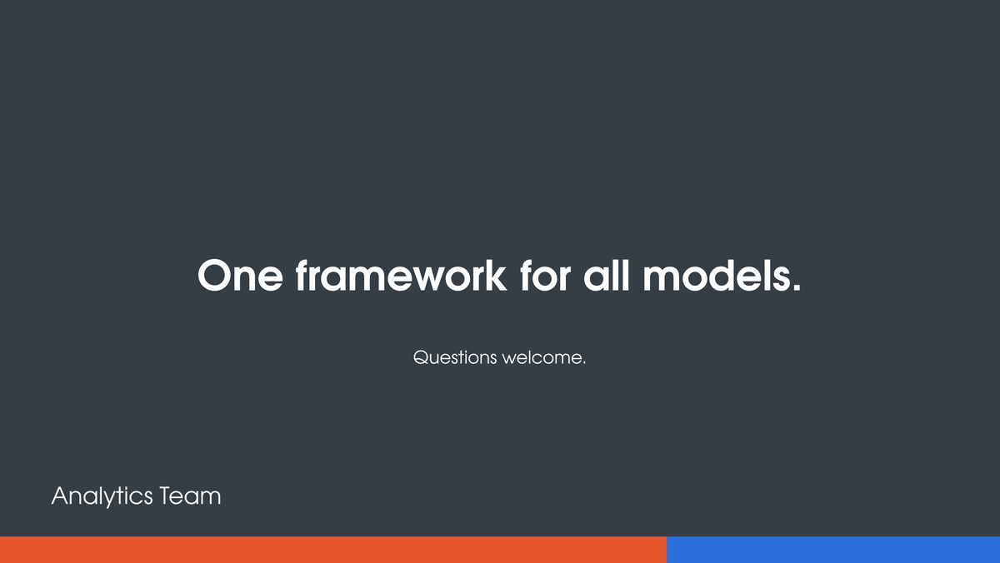
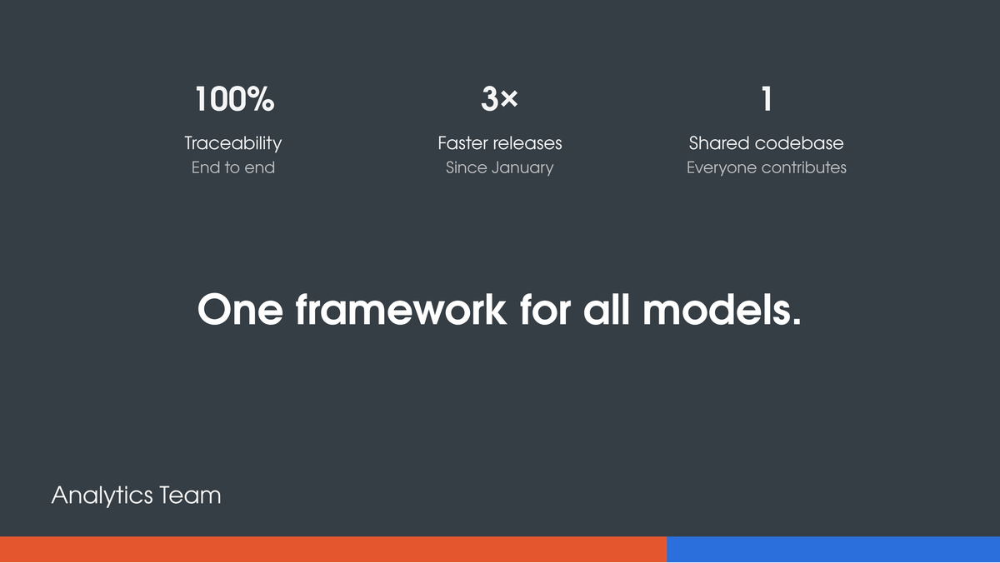

Esta página cubre la slide `Closing` y su fila de cifras.

## Un mensaje de cierre

```python
from banners import Closing

Closing(title="Un solo marco para todos los modelos.", subtitle="Preguntas bienvenidas.")
```

{width=80%}

Mantén el título corto y conclusivo: es la frase con la que se va la
audiencia. El equipo viene de `configure(team=...)`.

## Cifras clave

`stats` agrega una fila de cifras sobre el título. Cada cifra es una tupla con
un valor, una etiqueta y una nota:

```python
from banners import Closing

Closing(
    title="Un solo marco para todos los modelos.",
    stats=[
        ("100%", "Trazabilidad", "De punta a punta"),
        ("3×", "Despliegues más rápidos", "Desde enero"),
        ("1", "Código compartido", "Todos contribuyen"),
    ],
)
```

{width=80%}

Se leen mejor entre dos y cuatro cifras, con valores cortos.

## Solo el logo

`Closing(title="")` muestra el logo del template, centrado, y el equipo.
Necesita un template con logo; ver
[El template de tu organización](../howto/organization-template.qmd).

## Opciones

| Argumento | Por defecto | Significado |
|---|---|---|
| `title` | — | Mensaje final; `""` muestra el logo centrado. |
| `subtitle` | `""` | Frase de apoyo bajo el título. |
| `stats` | `None` | Lista de `(valor, etiqueta, nota)` que se muestra sobre el título. |
| `team` | `configure(team=...)` | Línea del equipo. |
| `palette` | la paleta de la presentación | Colores solo para esta slide. |
| `background` | `configure(background=...)` | Fondo del lienzo. |
