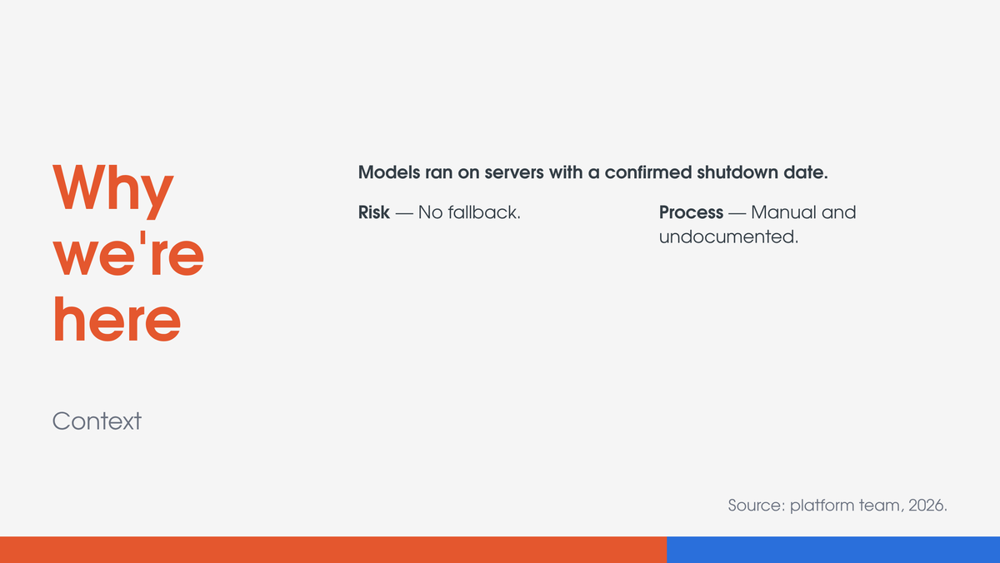

Esta página cubre la slide `Intro`, normalmente la segunda o tercera de una
charla, donde se plantea el problema o el contexto.

## Ejemplo

```python
from banners import Intro, Text

Intro(
    title="Por qué estamos aquí",
    tag="Contexto",
    summary="Los modelos corrían en servidores con fecha de apagado confirmada.",
    content=[Text("**Riesgo** — Sin respaldo."), Text("**Proceso** — Manual y sin documentar.")],
    footer="Fuente: equipo de plataforma, 2026.",
)
```

{width=80%}

El título ocupa la columna izquierda en letra grande. A la derecha, `summary`
plantea en negrita la idea que la audiencia debe recordar, y cada elemento de
`content` se vuelve una columna bajo ella.

## Opciones

| Argumento | Por defecto | Significado |
|---|---|---|
| `title` | — | Encabezado, en grande a la izquierda. |
| `subtitle` | `""` | Frase de apoyo bajo el título. |
| `tag` | `""` | Etiqueta corta bajo el título cuando no hay subtítulo, como `"Contexto"`. |
| `summary` | `""` | Frase clave en negrita sobre el contenido; acepta markdown. |
| `content` | `None` | Elementos que se muestran lado a lado a la derecha. |
| `footer` | `""` | Nota abajo a la derecha, como una fuente. |
| `team` | `configure(team=...)` | Línea del equipo. |
| `palette` | la paleta de la presentación | Colores solo para esta slide. |
| `background` | `configure(background=...)` | Fondo del lienzo. |
