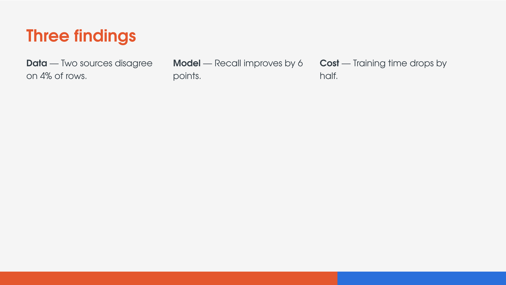

Esta página cubre `Section`, la slide que lleva la mayor parte de una charla:
cómo se numera, cómo se vuelve separador y sus opciones. El layout que toma
una sección depende de su contenido; [Layouts](../look/layouts.qmd) tiene las
reglas.

## Slides de contenido

```python
from banners import Section, Text

Section(
    title="Tres hallazgos",
    content=[
        Text("**Datos** — Dos fuentes difieren en el 4% de las filas."),
        Text("**Modelo** — El recall mejora en 6 puntos."),
        Text("**Costo** — El tiempo de entrenamiento baja a la mitad."),
    ],
)
```

{width=80%}

`content` recibe un elemento o una lista. Sirve cualquier elemento de la parte
de [Contenido](../content/text.qmd) de esta guía: texto, imágenes, tablas,
gráficos, diagramas y animaciones.

## Separadores

Sin contenido, una sección se vuelve un separador que abre una parte de la
charla. Muestra una foto o un ícono grande cuando el template tiene uno:

```python
from banners import Section, Template, configure

configure(template=Template(divider_icon="flow"))
Section(title="Arquitectura del pipeline", subtitle="Cómo se mueven los datos.")
```

{width=80%}

Los nombres de íconos son `chart`, `layers`, `target`, `compass`, `spark`,
`leaf`, `globe`, `shield`, `grid`, `orbit`, `pulse`, `building`, `flow` y
`mountain`. También sirve cualquier fuente de imagen.

## Numeración y colores por sección

Cada sección toma el número siguiente (`01`, `02`, …) cuando se crea. Como
marimo ejecuta las celdas en el orden del notebook, los números siguen el
orden de las celdas, y `configure()` reinicia la cuenta. Los layouts no
imprimen el número: este elige el color de la sección cuando la paleta tiene
`section_colors`, de modo que las secciones consecutivas recorren esos
colores. `number=` fija el número a mano:

```python
from banners import Palette, Section

arcoiris = Palette(section_colors=("#e4572e", "#2a6fdb", "#2e9e5b"))
Section(title="Cada sección toma el color siguiente", number="02", palette=arcoiris)
```

{width=80%}

## Opciones

| Argumento | Por defecto | Significado |
|---|---|---|
| `title` | — | Encabezado de la slide. |
| `subtitle` | `""` | Frase de apoyo bajo el título. |
| `content` | `None` | Un elemento o una lista; `None` crea un separador. |
| `number` | automático | Número de la sección; con `section_colors` elige el color. |
| `image` | el `divider_image` del template | Foto: mitad derecha de un separador, mitad izquierda de una slide de contenido; `False` oculta la foto del template. |
| `footer` | `""` | Nota abajo a la derecha. |
| `palette` | la paleta de la presentación | Colores solo para esta slide. |
| `background` | `configure(background=...)` | Fondo del lienzo. |
